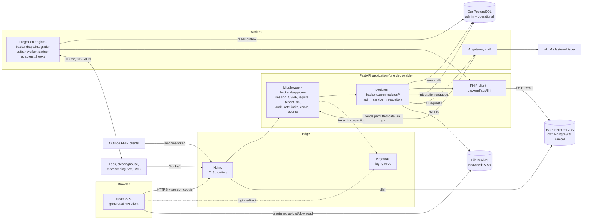

# Architecture context for the API

Status: **PROPOSED** · Version 0.1 · 2026-10-22 · Author: Vimal (drafted with Claude Code)
**Needs sign-off from:** Vimal, Thulasi (middleware, integration engine, events), Anand (HAPI, fhir client, files)

This page explains how an API request travels through the system, so contract decisions (IDs, async replies, errors when HAPI is down) can be traced to the architecture. It restates decided architecture with sources and marks anything new as PROPOSED.

## 1. Components

| Component | Owner | What it does for the API | Source |
|---|---|---|---|
| React SPA | Minalini (Vimal: AI screens) | Calls only `/api/v1` through the client generated from the contract. Never calls HAPI. | TW §1, CAT "FHIR for outside systems" |
| Nginx | Thulasi | TLS termination and routing. | TA ADR-22, D12 |
| Keycloak | Thulasi | Login (authorization code + PKCE), MFA. The browser never holds Keycloak tokens; the session cookie holds a reference token. | D3, CAT Thulasi section |
| Middleware (`backend/app/core/`) | Thulasi | Session, CSRF, `require()`, `tenant_db` (row-level security), audit, encryption, rate limits, error classes, `events.publish()`. | D3, VG §4 |
| Modules (`backend/app/modules/*`) | Per CODEOWNERS | Business rules. Thin routes, service, repository, Pydantic schemas. | TW §7 |
| FHIR client (`backend/app/fhir/`) | Anand | The only code that talks to HAPI. Holds all FHIR mappings. | D2, TW §2 |
| Integration engine (`backend/app/integration/`) | Thulasi | Outbox worker, partner adapters (HL7 v2/MLLP, X12, e-prescribing, fax, SMS), `/hooks/*` receivers, retries, dead-letter, replay. | D4, TA §7.1 |
| AI gateway (`ai/`) | Vimal | Kill switches, minimum data, output validation, prompt versions, metadata-only logs. Reaches patient data only through the API. | VG Step 7, TA §5.3 |
| Our PostgreSQL | Anand | Administrative and operational data. Row-level security per tenant. | D1, TA §6.1 |
| HAPI FHIR | Anand | Clinical data. Reached only through its FHIR API. | D1, D2 |
| File service | Anand | Quarantine, scan, hash, encrypt, store; short-lived links. | CAT Anand section, TA §9 |

## 2. Where data lives (summary)

Full per-resource detail is in [DATA_OWNERSHIP.md](DATA_OWNERSHIP.md).

| Pattern | Examples | Source |
|---|---|---|
| **Ours only** | Appointments, slots, eligibility checks, favorites, AI requests and reviews, billing and claims, inbox items, audit, integration messages | CAT storage notes, D1 |
| **Ours, mirrored to HAPI** | Patient (and identifiers, related persons, coverage — **pending Anand**); Practitioner, PractitionerRole, Organization, Location (**VD-G5, pending Anand**) | D7, VD-G5 |
| **Drafted in ours, written to HAPI on signing** | Notes (DocumentReference + Provenance), prescriptions (MedicationRequest) | D8 |
| **HAPI only** | Vitals and other observations, problems, allergies, family, social and surgical history, results | D1, VG Step 5–6, CAT |
| **Both, created at check-in** | Encounter: created by the encounter service at check-in or by `POST /encounters` (VD-G4). Whether our database also keeps an encounter row is **pending schema** | VG Step 3, VD-G4 |
| **Files** | Card images, audio, after-visit summary PDFs, faxes, raw partner payloads | CAT, TA §6 |

## 3. How a request is processed

1. Nginx terminates TLS and forwards `/api/v1/*` to FastAPI (TA §2.1).
2. Middleware resolves the session cookie to a user, roles and tenant context, checks the CSRF header on unsafe methods, applies rate limits, and sets the tenant for row-level security (D3). **Pending Thulasi:** exact order and names; see [SECURITY_MODEL.md](SECURITY_MODEL.md).
3. `require("<permission>")` checks the endpoint's `x-permission` before any data is read, so a denial reveals nothing about the record (API_STANDARDS §12).
4. The route validates input against the Pydantic schema that mirrors the contract, then calls the service.
5. The service reads and writes our PostgreSQL through `tenant_db`, calls the FHIR client for clinical data, and calls `integration.enqueue()` for anything that must reach HAPI asynchronously or a partner.
6. Middleware writes the audit event declared by the endpoint's `x-audit` (SECURITY_MODEL §6).
7. Errors are raised as `core/errors.py` classes and leave as Problem Details (API_STANDARDS §9).
8. Domain events are published with `events.publish()` and reach browsers over Server-Sent Events (EVENTS.md).

## 4. Key flows

### 4.1 Register a patient (D7, VG Step 2)

1. `POST /patients` → service checks for duplicates (similar name + same date of birth or phone; `duplicate_candidate`).
2. In one transaction in our PostgreSQL: insert the patient and an outbox row via `integration.enqueue("hapi", "patient.upsert", patientId)`.
3. Respond `201` with the patient. The front desk is not blocked by HAPI.
4. Integration engine worker calls `fhir.patients.upsert()` (Anand). Retries with backoff; dead-letters after the limit; nightly reconciliation (DATA_OWNERSHIP §3).

### 4.2 Book and check in (VG Step 3, VD-G3, VD-G4)

1. `POST /appointments` → lock the provider's day, check conflicts, insert, enqueue an eligibility check (VD-G3), publish `appointment.booked`.
2. `POST /appointments/{id}/check-in` → appointment status `checked-in`; the encounter service creates the Encounter (same service as `POST /encounters`); an eligibility check runs; `appointment.checked-in` is published so the status board updates.
3. **Decided by Vimal (2026-10-22):** check-in never blocks on HAPI; the Encounter reaches HAPI through the outbox (same reason as D7). This needs an encounter row in our database: **pending schema / Anand**.

### 4.3 Sign a note (D8, VG Step 5)

1. `PATCH /notes/{id}` autosaves the draft in our database with `If-Match`.
2. `POST /notes/{id}/sign` (with `If-Match`) → in one transaction: lock the version, record the signature, enqueue the HAPI write.
3. Worker writes DocumentReference + Provenance to HAPI as one FHIR transaction Bundle with client-assigned IDs, so retries cannot create duplicates (**pending Anand**).
4. `note.signed` is published; the inbox removes the "unsigned note" item.

### 4.4 AI note draft (VG Step 7, VD-G11)

1. Audio is uploaded through the file service and registered with `POST /encounters/{id}/audio` (recording consent checked).
2. `POST /ai/transcriptions` → `202` + operation. The worker transcribes; the transcript is saved in our database.
3. `POST /ai/note-drafts` → `202` + operation. The gateway sends only the transcript and template sections to the model, validates JSON output, drops anything not supported by the transcript, and saves the result as a **draft note** through the notes service, marked AI-generated.
4. The clinician edits and signs the note through the same notes endpoints as a hand-written note. Accept, edit and reject decisions go to `POST /ai/suggestions/{id}/decision`.

### 4.5 Lab result (TA §10.4, owned by Thulasi)

The integration engine receives the result, stores it raw, matches it, writes DiagnosticReport and Observation to HAPI through the FHIR client, and publishes `result.received`. The clinician's inbox updates over Server-Sent Events within 60 seconds (FRS FR-ORD-02).

## 5. Failure behavior the contract must express

| Failure | Behavior | Contract consequence |
|---|---|---|
| HAPI unavailable, front-desk write (patient, check-in) | Succeeds in our database; HAPI sync is queued (D7; check-in decided by Vimal 2026-10-22) | Normal `201`/`200`. No sync status in public responses (minimum necessary) — **PROPOSED** |
| HAPI unavailable, clinical write or read (vitals, history, signed-note read) | Fails fast | `503` with Problem code `clinical-store-unavailable` and `Retry-After`. **Accepted by Vimal for the MVP**; see §8 for the accepted risk |
| Partner unavailable (clearinghouse, lab, e-prescribing) | Request accepted and queued; status shows pending | `202` + operation, or the resource's own pending status (API_STANDARDS §13) |
| AI off for clinic or feature | Every non-AI workflow still works | AI endpoints return `409` `feature-disabled`; no other endpoint depends on AI (FRS §3.4) |
| AI model unavailable | Same as above, plus operation fails with a Problem | Operation `status: failed` with `ai-unavailable` |

## 6. Trust boundaries

| Boundary | Rule | Source |
|---|---|---|
| Internet → Nginx | TLS only; the browser holds no tokens | D3, TA §9 |
| Nginx → API | Every request authenticated by middleware except `public` endpoints | SECURITY_MODEL §3 |
| API → HAPI | Only through `backend/app/fhir/`; HAPI on a private network | D2, TA §8 |
| API → AI | AI receives only the fields the task needs; AI never queries a database directly | VG Step 7, TA §5.2 |
| Partners → `/hooks/*` | Signature-checked by middleware; stored raw before parsing | CAT, TA §7.1 |
| Outside FHIR clients → `/fhir` | Machine token check by Thulasi; not part of our OpenAPI contract (VD-SCOPE) | CAT |
| Browser ↔ file store | Presigned, short-lived URLs only; never logged | API_STANDARDS §15 |

## 7. Open points on this page

| Item | Pending | Proposed answer |
|---|---|---|
| Does our database keep an encounter row (needed for outbox-based Encounter creation, status board, billing)? | Anand, schema | Yes: encounter row in ours with the same UUID as the HAPI Encounter |
| Clinical writes when HAPI is down | Anand, Thulasi | Accepted by Vimal for the MVP: fail with 503; registration and check-in queue (§5, §8) |
| Is `integration.enqueue()` written in the caller's database transaction (true outbox)? | Thulasi | Yes; otherwise a crash can lose the HAPI write |

## 8. Accepted risks

| Risk | Decision | Impact | Mitigation | Revisit |
|---|---|---|---|---|
| **Rooming stops while HAPI is down.** Vitals, allergy updates and medication review need HAPI; with the "fail, don't queue" rule (§5) they return `503 clinical-store-unavailable`. | Accepted by Vimal for the MVP, 2026-10-22. Registration and check-in are exempt and queue through the outbox (D7). | Medical assistants cannot record vitals or update allergies during an outage; the clinician may see the patient without fresh vitals in the system. | HAPI availability monitoring and alerting (Thulasi, Anand); a paper fallback procedure for the pilot clinic; screens show a clear "clinical data unavailable, retry" state (Minalini). | After the pilot, with outage data: consider queuing vitals like registration. |

