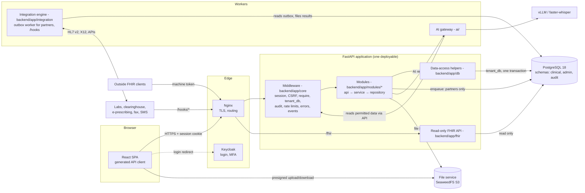

# Architecture context for the API

Status: **PROPOSED** · Version 0.2 · 2026-10-23 · Author: Vimal (drafted with Claude Code)
**Needs sign-off from:** Vimal, Thulasi (middleware, integration engine, events), Anand (database, `/fhir`, files)

This page explains how an API request travels through the system, so contract decisions (IDs, async replies, errors) can be traced to the architecture. It restates decided architecture with sources and marks anything new as PROPOSED.

**Since ADR-0011 (2026-10-23):** one PostgreSQL 18 database holds everything: FHIR-shaped clinical tables and normalized admin tables (D1). HAPI is retired.

## 1. Components

| Component | Owner | What it does for the API | Source |
|---|---|---|---|
| React SPA | Minalini (Vimal: AI screens) | Calls only `/api/v1` through the client generated from the contract. Never calls `/fhir`. | TW §1, D22 |
| Nginx | Thulasi | TLS termination and routing; Keycloak on the same origin at `/kc/`. | TA ADR-22, D12, T7 |
| Keycloak | Thulasi | Login (authorization code + PKCE), MFA. The browser never holds Keycloak tokens; the session cookie holds a reference token. | D3, ADR-0006 |
| Middleware (`backend/app/core/`) | Thulasi | Session, CSRF, `require()`, `tenant_db` (sets `app.current_tenant_id`, `app.current_user_id`, `app.correlation_id` for row-level security), audit, encryption, rate limits, error classes, `events.publish()`. | D3, D21 |
| Modules (`backend/app/modules/*`) | Per CODEOWNERS | Business rules. Thin routes, service, repository (maps database names to contract camelCase, D20), Pydantic schemas. | TW §7 |
| Data-access helpers (`backend/app/db/`) | Anand | Create, update with version check, entered-in-error and history for FHIR-shaped records, with Provenance. | Anand's guide v2, Step 3 |
| Read-only FHIR API (`backend/app/fhir/`) | Anand | Serves the clinical tables to outside systems: read, version read, history, search (GET and `POST _search`), CapabilityStatement; OperationOutcome errors; query strings stripped from logs. | D22, ADR-0011 |
| Integration engine (`backend/app/integration/`) | Thulasi | Outbox worker for partners only, partner adapters (HL7 v2/MLLP, X12, e-prescribing, fax, SMS), `/hooks/*` receivers, retries, dead-letter, replay. | D4, D25, TA §7.1 |
| AI gateway (`ai/`) | Vimal | Kill switches, minimum data, output validation, prompt versions, metadata-only logs. Reaches patient data only through the API. | VG Step 7, TA §5.3 |
| PostgreSQL 18 | Anand | All data, in three schemas (`clinical`, `admin`, `audit`), one role per service, forced row-level security. | D1, D23 |
| File service | Anand | Quarantine, scan, hash, encrypt, store; short-lived links. | CAT Anand section, TA §9 |

## 2. Where data lives (summary)

Full per-resource detail is in [DATA_OWNERSHIP.md](DATA_OWNERSHIP.md).

| Pattern | Examples | Source |
|---|---|---|
| **Clinical** (FHIR-shaped, schema `clinical`) | Patient, related persons, coverage, consents, appointments, encounters, vitals and observations, diagnoses and problems, allergies, history, notes (Composition), prescriptions, orders, results, documents, Provenance | D1, P0_SCHEMA_SCOPE.md |
| **Admin** (normalized, schema `admin`) | Settings, users and roles, scheduling setup, visit flow, eligibility, favorites, templates, billing and claims, inbox, communications, AI records, integration messages | D1 |
| **Audit** (schema `audit`) | Append-only, hash-chained audit events; break-glass | D23 |
| **Files** | Card images, audio, after-visit summary PDFs, faxes, raw partner payloads | CAT, TA §6 |

## 3. How a request is processed

1. Nginx terminates TLS and forwards `/api/v1/*` to FastAPI (TA §2.1).
2. Middleware resolves the session cookie to a user, roles and clinic, checks CSRF and `Origin` on unsafe methods, applies rate limits, and opens the transaction with the row-level security settings (D3, D21; SECURITY_MODEL §3).
3. `require("<permission>")` checks the endpoint's `x-permission` before any data is read, so a denial reveals nothing about the record (API_STANDARDS §12).
4. The route validates input against the Pydantic schema that mirrors the contract, then calls the service.
5. The service writes through its repository and Anand's helpers, in **one transaction**: clinical rows, admin rows, Provenance, the audit event, and an outbox row only when a partner must be told (D25).
6. Middleware writes the audit event declared by the endpoint's `x-audit`; audit fails closed (SECURITY_MODEL §6).
7. Errors are raised as `core/errors.py` classes and leave as Problem Details (API_STANDARDS §9).
8. Domain events are published with `events.publish()` and reach browsers over Server-Sent Events (EVENTS.md).

## 4. Key flows

### 4.1 Register a patient (D7, VG Step 2)

1. `POST /patients/search` first; then `POST /patients` → the service checks for duplicates (similar name + same date of birth or phone).
2. In one transaction: insert the Patient row (and identifiers, related persons, coverage), its Provenance and the audit event.
3. Respond `201` with the patient.

### 4.2 Book and check in (VG Step 3, VD-G3, VD-G4)

1. `POST /appointments` → in one transaction: lock the provider's day, insert the Appointment (the database's exclusion constraint also refuses double booking), queue an eligibility check for the clearinghouse (outbox, D25), publish `appointment.booked`.
2. `POST /appointments/{appointmentId}/check-in` → in one transaction: appointment status `checked-in`, and the encounter service creates the Encounter row (same service as `POST /encounters`). The real-time eligibility check goes to the clearinghouse through the outbox. `appointment.checked-in` is published so the status board updates.

### 4.3 Sign a note (D8, VG Step 5)

1. `PATCH /notes/{noteId}` autosaves the draft Composition with `If-Match`; every version is kept.
2. `POST /notes/{noteId}/sign` (with `If-Match`) → in one transaction: lock the row, write Provenance, write the audit event. The signed note row is the legal record.
3. `note.signed` is published; the inbox removes the "unsigned note" item.

### 4.4 AI note draft (VG Step 7, VD-G11)

1. Audio is uploaded through the file service and registered with `POST /encounters/{encounterId}/audio`. The database requires an active recording consent of the same patient.
2. `POST /ai/transcriptions` → `202` + operation. The worker transcribes; the transcript is saved in our database.
3. `POST /ai/note-drafts` → `202` + operation. The gateway sends only the transcript and template sections to the model, validates the JSON output, drops anything not supported by the transcript, and saves the result as a **draft note** through the notes service, marked AI-generated.
4. The clinician edits and signs the note through the same notes endpoints as a hand-written note. Accept, edit and reject decisions go to `POST /ai/suggestions/{suggestionId}/decision`.

### 4.5 Lab result (TA §10.4, owned by Thulasi)

The integration engine receives the result and stores it raw. It matches the result, then files the DiagnosticReport and Observations in one transaction (the integration role may file results, D23) and publishes `result.received`. The clinician's inbox updates over Server-Sent Events within 60 seconds (FRS FR-ORD-02).

## 5. Failure behavior the contract must express

| Failure | Behavior | Contract consequence |
|---|---|---|
| Database unavailable or overloaded | The request fails as a whole; nothing is half-written | `503 service-unavailable` with `Retry-After` |
| Partner unavailable (clearinghouse, lab, e-prescribing, fax, SMS) | Our side commits; the partner message waits in the outbox and is retried (§8) | `202` + operation, or the resource's own pending status (API_STANDARDS §13) |
| AI off for clinic or feature | Every non-AI workflow still works | AI endpoints return `409 feature-disabled`; no other endpoint depends on AI (FRS §3.4) |
| AI model unavailable | Same as above, plus the operation fails with a Problem | Operation `status: failed` with `ai-unavailable` |

## 6. Trust boundaries

| Boundary | Rule | Source |
|---|---|---|
| Internet → Nginx | TLS only; the browser holds no tokens | D3, TA §9 |
| Nginx → API | Every request authenticated by middleware except `public` endpoints | SECURITY_MODEL §3 |
| API → database | Through `tenant_db` and the module's repository only; the application role never bypasses row-level security | D21, D23 |
| API → AI | AI receives only the fields the task needs; AI never queries a database directly | VG Step 7, TA §5.2 |
| Partners → `/hooks/*` | Signature-checked by middleware; stored raw before parsing | CAT, TA §7.1 |
| Outside FHIR clients → `/fhir` | Machine token checked by Thulasi; clinic from the token; read only, with the `shri_fhir_reader` role; not part of our OpenAPI contract | D22, D23, VD-SCOPE |
| Browser ↔ file store | Presigned, short-lived URLs only; never logged | API_STANDARDS §15 |

## 7. Open points on this page

None about storage; ADR-0011 settled them. The `enqueue()` signature change (outbox in the caller's transaction) comes as a separate core PR from Thulasi that all four review (DECISIONS.md "Still open").

## 8. Partner outages (replaces the HAPI-down accepted risk)

The HAPI-down accepted risk ("rooming stops while HAPI is down") is **retired by ADR-0011**: there is no HAPI, so rooming, vitals and history depend only on our own database. What remains is partners being unavailable. The outbox handles that:

| Partner down | What happens | What the screen shows | Recovery |
|---|---|---|---|
| Clearinghouse (eligibility, claims, status) | Booking, check-in and claim submission commit; the 270, 837P or 276 waits in the outbox | Eligibility "pending" or "unable to verify"; claim `submitted` (queued) | Retries with backoff; the dead-letter queue raises an alert; an operator replays from `/admin/integration-messages`; front desk can re-run a manual check |
| E-prescribing vendor | The prescription is signed and locked; NewRx waits in the outbox | `transmissionStatus: queued` | Same retries; failures go to the prescriber's inbox |
| Lab | The order is signed; the HL7 order waits in the outbox | Order `signed`, not yet `transmitted` | Same retries; the manual fallback (print the requisition) remains (IP risks) |
| Fax, SMS | Message queued | Delivery status pending | Same retries |

Nothing in our own database waits on a partner, and no clinical write is ever queued (D25).
