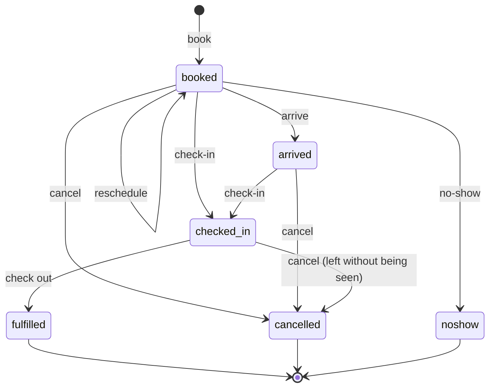
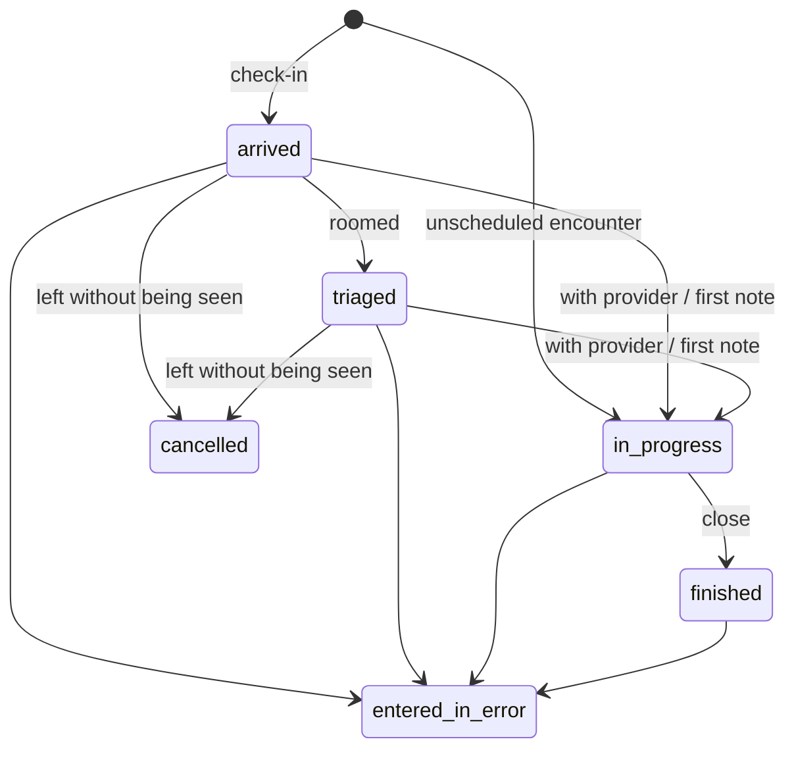
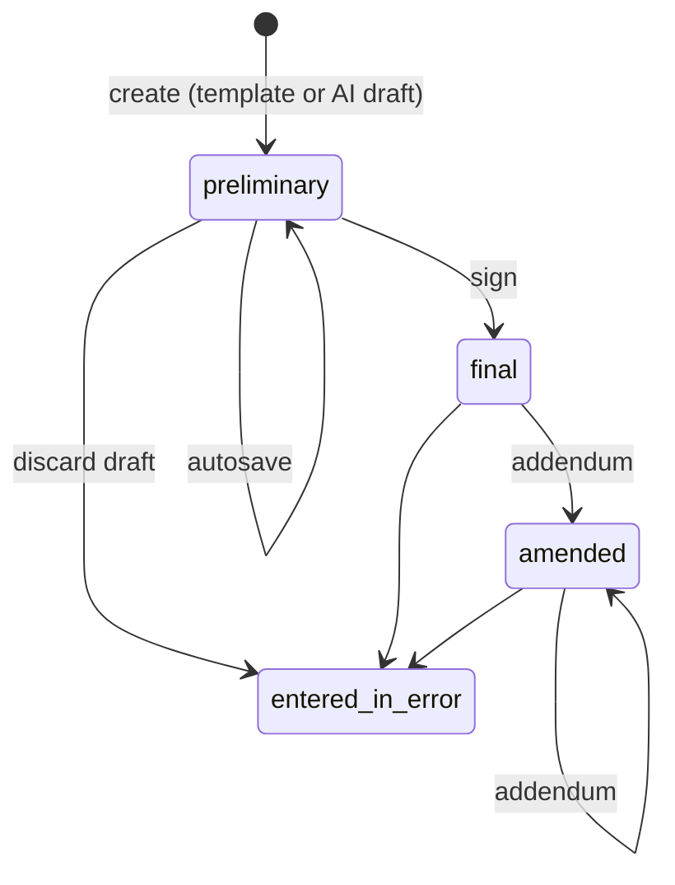
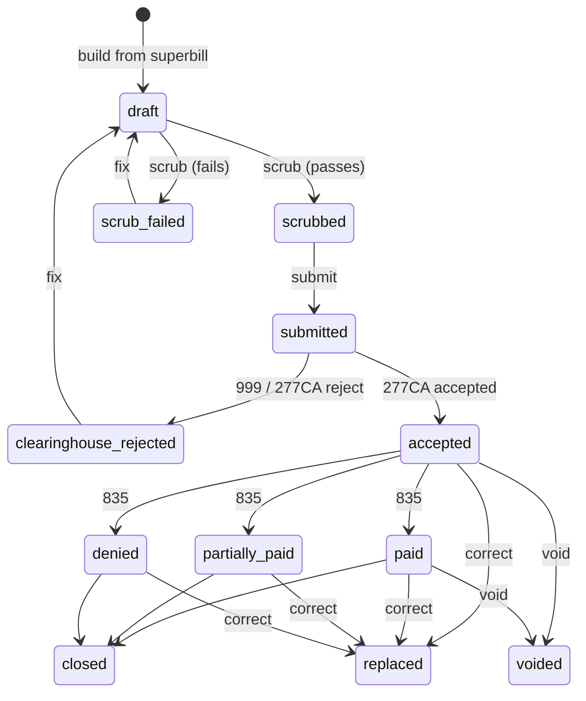

# Data ownership, consistency and lifecycles

Status: **PROPOSED** · Version 0.1 · 2026-10-22 · Author: Vimal (drafted with Claude Code)
**Needs sign-off from:** Anand (system of record, FHIR mappings, schema). Also Vimal (Vimal's modules), Thulasi (medications, orders, integration engine outbox; **signed off on issue #3, 2026-10-22**, additions applied in §2.2, §3.1, §3.4, §5.4–§5.6), Anand and the RCM analyst (claims).

**Pending schema (VD-G7):** the baseline (83 vs 89 tables) and the list of tables that move to HAPI are not settled (DEC "Still open"). Every table name and every "our database also keeps a row" statement below is marked **pending schema** and will be finalized when the schema is loaded. Stage 4 does not start until then.

Fixed by source documents:

- Clinical data lives in HAPI FHIR; administrative and operational data in our PostgreSQL (D1).
- HAPI is reached only through its FHIR API, via `backend/app/fhir/` (D2).
- Registration is stored in our database and mirrored to a FHIR Patient on every change, through the integration engine, so a HAPI outage never blocks the front desk (D7).
- Notes and prescriptions: drafts and versions in our database; on signing, written to HAPI (DocumentReference, MedicationRequest) with a Provenance record (D8).
- Storage per endpoint group as in CAT; placement of encounters, vitals, diagnoses, notes and favorites as in VG Step 5; history in HAPI as in VG Step 6.

---

## 1. Storage patterns

| Code | Pattern | Consistency | Used for |
|---|---|---|---|
| **O** | Ours only | One PostgreSQL transaction | Scheduling, eligibility, billing, inbox, AI records, settings, audit |
| **M** | Ours is the source of truth, **mirrored** to HAPI | Outbox → asynchronous upsert to HAPI (§3.1) | Patient (D7); Practitioner, PractitionerRole, Organization, Location (VD-G5, **pending Anand**); Coverage (**pending Anand**) |
| **S** | **Drafted** in ours, written to HAPI **on signing** | Ours commits the signature; outbox writes the FHIR transaction (§3.2) | Notes (D8), prescriptions (D8), orders (**PROPOSED**, same reasoning) |
| **H** | **HAPI only** (our database may hold a pointer, **pending schema**) | Synchronous FHIR call inside the request (§3.3) | Vitals, problems, allergies, family, social and surgical history, results |
| **B** | **Both**, created together | Row in ours + outbox to HAPI (§3.1) | Encounter (VD-G4). Check-in never blocks on HAPI (Vimal, 2026-10-22), which requires this pattern: **pending schema / Anand** |
| **F** | Files | File service; our database stores the file ID | Card images, audio, PDFs, faxes, raw partner payloads (TA §6) |
| **C** | Computed | Read-only view over other data | Slots, status board, timeline, reports, dashboards |

## 2. Resources

US Core profiles are named from **US Core 9.0.0**, the current published version on hl7.org as checked on 2026-10-22 (based on FHIR R4 4.0.1). **Pending Anand:** which US Core version we target; if certification matters (TA ADR-16) the required version may differ, and some profile names change between versions.

### 2.1 Vimal's resources

| Resource | API (base `/api/v1`) | Record | FHIR resource | US Core profile | Concurrency | Tables (pending schema) |
|---|---|---|---|---|---|---|
| Patient (demographics, contacts) | `/patients`, `/patients/{patientId}` | **M** | Patient | US Core Patient | Row version → ETag; `If-Match` on PATCH | `patient` |
| Patient identifiers (MRN, driver's license) | `/patients/{patientId}/identifiers` | **M** (part of Patient) | Patient.identifier | (US Core Patient) | Parent's ETag | `patient_identifier` |
| Related persons, emergency contacts | `/patients/{patientId}/related-persons` (new, VD missing-endpoints) | **M** | **PROPOSED**: `Patient.contact` for emergency contacts; RelatedPerson only for legal representatives — **pending Anand** | US Core RelatedPerson (if RelatedPerson) | Row version | `related_person` |
| Coverage (insurance) | `/patients/{patientId}/coverages` | **O**, mirror **M** proposed | Coverage | US Core Coverage | Row version; `If-Match` on PATCH | `coverage`, `payer` |
| Card images | `…/coverages/{coverageId}/card-images` | **F** | — | — | Append-only | `coverage` (file IDs) |
| Consents | `/patients/{patientId}/consents` | **O** | Consent (no mirror in MVP) — **PROPOSED** | none in US Core 9.0.0 | Insert-only; revocation is a new record | `consent` |
| Preferred pharmacy | `/patients/{patientId}/preferred-pharmacy` | **O** | — | — | Row version | `patient_pharmacy` |
| Restriction flag | `/patients/{patientId}/restrict`, `/unrestrict` (new) | **O** | — | — | State action | `patient.is_restricted` |
| Timeline | `/patients/{patientId}/timeline` | **C** (ours + HAPI) | — | — | Read-only | — |
| Duplicates, merges | `/duplicates`, `/duplicates/{duplicateId}/merge`, `/patient-merges/{mergeId}/undo` | **O** + HAPI link | Patient.link (`replaced-by` / `replaces`) — **pending Anand** | US Core Patient | Lock both patients during merge | `duplicate_candidate`, `patient_merge` |
| Slots | `/slots` | **C** | — | — | Read-only | `schedule_availability_rule`, `schedule_exception`, `appointment` |
| Appointment | `/appointments`, `/appointments/{appointmentId}` | **O** (not mirrored in MVP; **PROPOSED**) | Appointment (if ever mirrored) | none in US Core 9.0.0 | Row version; booking takes a provider-day lock (VG Step 3) | `appointment` |
| Status board | `/status-board` | **C** | — | — | Read-only | — |
| Eligibility check | `/eligibility-checks`, `/appointments/{appointmentId}/eligibility-checks` (new) | **O** + **F** (raw X12) | — (CoverageEligibilityResponse not used) | — | Insert-only; status by system | `eligibility_check` |
| Encounter | `/encounters`, `/encounters/{encounterId}` | **B** (**pending schema / Anand**) | Encounter | US Core Encounter | Row version; HAPI writes via outbox | `encounter` |
| Vitals | `/encounters/{encounterId}/vitals`, `/patients/{patientId}/vitals` | **H** | Observation (category `vital-signs`) | US Core Vital Signs, plus the specific profiles (Blood Pressure, Body Height, Body Weight, BMI, Body Temperature, Heart Rate, Respiratory Rate, Pulse Oximetry, Head Circumference) | Insert-only; corrections are entered-in-error + new | — (HAPI) |
| Encounter diagnoses | `/encounters/{encounterId}/diagnoses` | **S** (option B, accepted by Vimal 2026-10-22; §2.5) | Condition (category `encounter-diagnosis`), written on signing | US Core Condition Encounter Diagnosis | Draft rows in ours; HAPI version after signing | `condition`, `encounter_diagnosis` (pending schema) |
| Code search | `/codes/search` | **O** (Anand's terminology tables) | — | — | Read-only | `code_system`, `concept` |
| Note (draft and versions) | `/encounters/{encounterId}/notes`, `/notes/{noteId}`, `/notes/{noteId}/versions` | **S** | DocumentReference (on signing) + Provenance | US Core DocumentReference; US Core Provenance | Row version; `If-Match` on PATCH and sign (VG Step 5) | `clinical_note`, `clinical_note_version` |
| Addendum | `/notes/{noteId}/addenda` | **S** | DocumentReference with `relatesTo.code = appends` + Provenance — **pending Anand** | US Core DocumentReference; US Core Provenance | Insert-only | `note_addendum` |
| Co-signature | `/notes/{noteId}/cosign` | **S** | Provenance (cosigner as an additional agent) — **pending Anand** | US Core Provenance | `If-Match` on the note | `clinical_note` (supervisor fields) |
| Co-signature rules | `/cosign-rules` (new) | **O** | — | — | Row version | **pending schema** (TA §6.1 says supervising practitioner and co-signature are modelled; rule configuration table unknown) |
| Favorites | `/me/favorites` | **O** | — | — | Row version, PUT with `If-Match` | `user_clinical_preference` (P0 gap table, TA §6.2) |
| After-visit summary | `/encounters/{encounterId}/after-visit-summary` | **F** + **O** | DocumentReference (patient-facing) — **pending Anand** | US Core DocumentReference | Generated per signed note version | `document` |
| Problem list | `/patients/{patientId}/problems` | **H** | Condition (category `problem-list-item`) | US Core Condition Problems and Health Concerns | HAPI version via FHIR client; `If-Match` on PATCH | — (HAPI) |
| Allergies | `/patients/{patientId}/allergies` | **H** | AllergyIntolerance | US Core AllergyIntolerance | Same | — (HAPI) |
| Family history | `/patients/{patientId}/family-history` | **H** | FamilyMemberHistory | US Core FamilyMemberHistory (present in 9.0.0; check for the version we target) | Insert + entered-in-error | — (HAPI); TA §6.2 proposed a `family_member_history` table before D1 |
| Social history | `/patients/{patientId}/social-history` | **H** | Observation (category `social-history`) | US Core Smoking Status Observation (smoking); US Core Simple Observation or Observation Occupation for others — **pending Anand** | Insert + entered-in-error | — (HAPI) |
| Surgical history | `/patients/{patientId}/surgical-history` | **H** | Procedure | US Core Procedure | Insert + entered-in-error | — (HAPI) |
| Encounter audio | `/encounters/{encounterId}/audio` | **F** + **O** | — | — | Insert-only | `audio_recording` |
| Transcription | `/ai/transcriptions` | **O** | — | — | Insert-only; edits are new versions | `transcript`, `ai_request` |
| AI note draft | `/ai/note-drafts` | **O** (becomes a draft note) | — | — | — | `ai_request`, `ai_suggestion`, `clinical_note` |
| Chart summary | `/ai/chart-summaries` | **O** | — | — | Insert-only | `ai_request`, `ai_suggestion` |
| AI decision | `/ai/suggestions/{suggestionId}/decision` | **O** | Provenance on the signed note records AI involvement — **pending Anand** | US Core Provenance | Once per suggestion | `ai_suggestion` |
| AI settings | `/admin/ai-settings` | **O** | — | — | Row version, PUT with `If-Match` | `ai_feature_setting` |

### 2.2 Thulasi's resources (pending Thulasi)

| Resource | API | Record | FHIR resource | US Core profile | Concurrency |
|---|---|---|---|---|---|
| Users, roles | `/users`, `/roles`, `/users/{userId}/roles` | **O** (synced with Keycloak) | Practitioner link for clinical users (VD-G5) | US Core Practitioner | Row version |
| Audit events | `/audit-events`, `/reports/chart-access` | **O** (append-only, hash chain, TA §6) | AuditEvent (not exposed in MVP) | — | Append-only |
| Break-glass grants | `/patients/{patientId}/break-glass` | **O** | — | — | Insert-only |
| Integration messages | `/admin/integration-messages` | **O** + **F** (raw payloads) | — | — | System only |
| Medication list | `/patients/{patientId}/medications` | **H** | MedicationRequest (US Core represents medication lists with MedicationRequest, including patient-reported): `intent` and `reported[x]` mark patient-reported items (agreed, Thulasi T36; **Anand to confirm the mapping**) | US Core MedicationRequest; US Core Medication | HAPI version |
| Prescription | `/prescriptions` | **S** (D8) | MedicationRequest + Provenance | US Core MedicationRequest; US Core Provenance | `If-Match` on edits and sign-and-send |
| Safety alerts, overrides | `/prescriptions/{prescriptionId}/safety-check`, `/alerts/{alertId}/override` | **O** | — | — | Insert-only |
| Refill and change requests | `/refill-requests` with `type`: `renewal` \| `change` (pharmacy-initiated NCPDP RxChangeRequest arrives through `/hooks/erx`; depends on the e-prescribing vendor; T35) | **O** + integration | MedicationRequest on approval | US Core MedicationRequest | State machine |
| Pharmacy directory | `/pharmacies` | **O** | Organization (if mirrored) | US Core Organization | Read-only |
| Outside medication history | `/patients/{patientId}/medication-history/fetch` | **H** | MedicationDispense / MedicationRequest | US Core MedicationDispense | Insert-only |
| Lab compendium | `/lab-compendium` | **O** | — | — | Read-only (loaded by Anand's onboarding) |
| Order | `/orders` | **S** (**PROPOSED**) | ServiceRequest + Provenance | US Core ServiceRequest; US Core Provenance | `If-Match` on edits |
| Order status history | (inside `/orders/{orderId}`) | **O** | — | — | Append-only (`service_request_status_event`, P0 gap table) |
| Specimen | (inside orders) | **H** | Specimen | US Core Specimen | — |
| Result | `/results` | **H** | DiagnosticReport + Observation | US Core DiagnosticReport Profile for Laboratory Results Reporting; US Core Laboratory Result Observation | Versions by lab corrections |
| Result acknowledgement | `/results/{resultId}/acknowledge` | **O** | — | — | Insert-only |
| Unmatched results | `/unmatched-results` | **O** + **F** | — | — | State machine |
| In-office results | `/encounters/{encounterId}/in-office-results` | **H** | Observation | US Core Laboratory Result Observation or US Core Observation Clinical Result — **pending Thulasi/Anand** | Insert-only |

### 2.3 Anand's resources (pending Anand)

| Resource | API | Record | FHIR resource | US Core profile |
|---|---|---|---|---|
| Files | `/files/…` | **F** + **O** metadata | — | — |
| Facilities, locations | `/facilities`, `/locations` | **M** (VD-G5) | Organization, Location | US Core Organization, US Core Location |
| Providers | `/providers` | **M** (VD-G5) | Practitioner, PractitionerRole | US Core Practitioner, US Core PractitionerRole |
| Appointment types, provider schedules, fee schedules, lab accounts, note templates | `/appointment-types`, `/provider-schedules`, `/fee-schedules`, `/lab-accounts`, `/note-templates` | **O** | — | — |
| Payers | `/payers` | **O**; mirrored as Organization if Coverage is mirrored | Organization | US Core Organization |
| Onboarding import | `/onboarding/import` | **O** + **F** | — | — |
| Superbill, charges | `/encounters/{encounterId}/superbill` | **O** | — | — |
| Claims, claim status events | `/claims` | **O** + **F** (X12) | — (Claim not used) | — |
| Patient payments, card sessions | `/patients/{patientId}/payments`, `/payments/card-session` | **O** (card data stays with the processor, FRS FR-RCM-03) | — | — |
| Remittances | `/remittances` | **O** + **F** (835) | — | — |
| Billing reports | `/reports/ar-aging`, `/reports/charges-payments` | **C** | — | — |
| Documents | `/documents`, `/patients/{patientId}/documents` | **O** + **F**; clinical documents also as DocumentReference — **pending Anand** | DocumentReference | US Core DocumentReference |
| Faxes, fax inbox | `/faxes`, `/fax-inbox` | **O** + **F** | — | — |
| C-CDA import and export | `/ccda/import`, `/patients/{patientId}/ccda` | **F** + **O**; imported document as DocumentReference | DocumentReference | US Core DocumentReference |
| Inbox, messages | `/inbox`, `/messages` | **O** (`work_queue_item`) | — | — |
| Exports | `/exports` | **O** + **F** | — | — |

### 2.4 Minalini's resources (pending Minalini)

| Resource | API | Record |
|---|---|---|
| Message templates | `/message-templates` | **O** |
| Communication preferences | `/patients/{patientId}/communication-preferences` | **O** |
| Communications log | `/patients/{patientId}/communications` | **O** (`outbound_communication`) |
| Operations dashboard | `/dashboards/operations` | **C** |

### 2.5 When encounter diagnoses reach HAPI (decided: option B)

VG Step 5 places diagnoses (Condition) in HAPI. VD-G1 says a diagnosis can be **removed** while the encounter is unsigned, and is only marked entered-in-error after signing. Two ways to build that:

| Option | How | For | Against |
|---|---|---|---|
| A. HAPI immediately | Each add writes a Condition to HAPI. "Remove" sets `verificationStatus = entered-in-error` in HAPI (there is no DELETE). | Matches VG Step 5 literally; other clinicians see diagnoses in HAPI at once | HAPI fills with removed draft diagnoses; outside FHIR clients can see unsigned working diagnoses; "remove" and "entered-in-error" look the same in FHIR |
| B. Draft in ours, HAPI on signing (**accepted**) | Unsigned diagnoses live in our database (like note drafts, D8). On note signing or encounter close, they are written to HAPI as Conditions with Provenance. Remove = real removal of a draft row; after signing only entered-in-error. | Same pattern as D8; remove means remove; AI-04 suggestions fit; billing reads from ours at close | Departs from VG Step 5 wording (the data still ends up in HAPI); needs our `encounter_diagnosis` table (**pending schema**) |

**Decision (Vimal, 2026-10-22): option B.** Diagnoses are drafted in our database until the encounter is signed, then written to HAPI as Conditions. **Still needs Anand** for the draft table (`encounter_diagnosis`, pending schema); recorded in DECISIONS.md "Still open".

How it works:

1. While unsigned: `POST …/diagnoses` inserts a draft row; `POST …/diagnoses/{diagnosisId}/remove` deletes the draft row (VD-G1). Nothing goes to HAPI.
2. **"The encounter is signed"** means its first note reaches `final` (§5.3). **PROPOSED, pending Vimal** (the encounter itself has no signature in the state machine, §5.2).
3. On that signing, the same outbox job that writes the DocumentReference also writes every draft diagnosis as a Condition (`encounter-diagnosis`) with Provenance, in one FHIR transaction Bundle (§3.2).
4. After signing: a diagnosis added later is written to HAPI at once (pattern H, §3.3), and existing ones can only be marked entered-in-error (`POST …/diagnoses/{diagnosisId}/entered-in-error`). **PROPOSED, pending Vimal.**

## 3. Keeping the two databases consistent

### 3.1 Mirrored and "both" resources (patterns M and B)

**PROPOSED, pending Thulasi (outbox) and Anand (FHIR client).**

1. **Transactional outbox.** The change and its outbox row (`integration.enqueue("hapi", "<resource>.upsert", id)`) are written in **the same database transaction**. If the transaction rolls back, nothing is sent; if it commits, the job exists. **Agreed by Thulasi (T29):** `enqueue()` takes the caller's session: `enqueue(db, partner, message_type, payload, idempotency_key, ordering_key=None)`. Payloads for `hapi` jobs carry IDs only. Workers claim jobs across clinics with `SKIP LOCKED`, then run each job with its own clinic set, the same way `tenant_db` does.
   > **Core change, all-four review.** Changing `enqueue()`'s signature changes a shared core function, so Thulasi's PR for it is reviewed by all four of us (Vimal, Thulasi, Anand, Minalini) before merge.
2. **Job carries the ID only.** The worker loads the **current** row when it runs, not a snapshot. Older jobs for the same record therefore send the latest data, so out-of-order delivery cannot restore stale data.
3. **Idempotent write.** The HAPI resource has the **same ID** as our record (client-assigned UUID; API_STANDARDS §5) and carries our identifier: `identifier.system = <our system URI>`, `identifier.value = <our UUID>`. The worker does `PUT <Type>/<uuid>` (update-as-create). If client-assigned IDs are not allowed in HAPI's configuration, the fallback is a conditional update `PUT <Type>?identifier=<system>|<uuid>` (create if absent). Either way, retries never create duplicates. **Pending Anand:** HAPI configuration and the identifier system URI (PROPOSED: `https://fhir.<COMPANY_DOMAIN>/sid/<resource>-id`, built from `COMPANY_DOMAIN`, API_STANDARDS §0, still open).
4. **Ordering per record.** Jobs are processed in order per record key (for example per `patientId`); different records run in parallel.
5. **Dependencies.** An Encounter references Patient, Practitioner and Location. The worker sends a FHIR **transaction Bundle** that contains conditional upserts of the referenced mirrors with the Encounter, so references always resolve. **Pending Anand.**
6. **Retries.** Exponential backoff with jitter; after the retry limit the job goes to the dead-letter queue with an alert, and an operator can replay it from Thulasi's integration message screen (`/admin/integration-messages/{id}/replay`, TA §7.1).
7. **Nightly reconciliation.** A job compares each mirrored record's version in ours with the version recorded on the HAPI resource (our version is stored in `meta.tag` or an extension, **pending Anand**), re-enqueues mismatches, and reports counts. Runs per tenant.
8. **Reads.** Screens read mirrored data (patients, providers, coverage) from **ours**, the source of truth, so a lagging mirror is never visible to staff. Only outside FHIR clients and HAPI-side references see the mirror.

### 3.2 Signed records (pattern S: notes, prescriptions, orders)

1. Signing commits in ours first: the signed version becomes insert-only and locked (TA §6.1 triggers block signed → draft).
2. In the same transaction, an outbox job is created.
3. The worker writes **one FHIR transaction Bundle** (DocumentReference or MedicationRequest or ServiceRequest **plus** its Provenance) with client-assigned IDs. HAPI applies the Bundle atomically, and retries are idempotent.
4. Our record shows whether the HAPI copy exists (internal field, not in public responses — **PROPOSED**).
5. **Legal record of a signed note. PROPOSED by Vimal (2026-10-22); needs Anand's sign-off and compliance confirmation:**
   - The **signed version in our database** is the legal record: immutable (insert-only, TA §6.1), hash-chained and audited.
   - The **HAPI DocumentReference** is the clinical and interoperability copy. It carries the **same content hash** as the signed version.
   - Nightly reconciliation (§3.1 step 7) compares the two hashes for every signed note and alerts on any mismatch.
   - **Pending Anand:** where the hash goes in FHIR. FHIR R4 `Attachment.hash` is defined as a SHA-1 hash; if we use SHA-256 (recommended), it needs an extension or identifier on the DocumentReference.
   - Recorded in DECISIONS.md "Still open".

### 3.3 HAPI-only resources (pattern H)

1. The service calls the FHIR client synchronously inside the request.
2. HAPI down or timing out → `503 clinical-store-unavailable` or `504 upstream-timeout`; nothing is queued, so the clinician never sees unconfirmed clinical data. **Accepted by Vimal for the MVP (2026-10-22); needs Anand and Thulasi.** Exception: patient registration and check-in never block; they queue through the outbox, as in D7 (§3.1). The rooming impact is an accepted risk (ARCHITECTURE_CONTEXT §8).
3. If ours also stores a pointer row (**pending schema**), it is written **after** HAPI succeeds. An orphan in HAPI (HAPI succeeded, our commit failed) is harmless because the client-assigned ID makes the client's retry (same `Idempotency-Key`) land on the same resource, and reconciliation reports orphans.
4. Version conflicts use HAPI's versioning through the FHIR client (API_STANDARDS §11).

### 3.4 Tenant isolation in HAPI

Our PostgreSQL isolates clinics with row-level security. HAPI needs its own isolation.

**Agreed by Thulasi (T30), design is Anand's:** one HAPI partition per organization. The FHIR client takes the tenant from the same request context as `tenant_db` (or from the job, for outbox workers), never from input. Outside `/fhir` clients get their partition from their machine-token claims.

**Open, Anand's design decision (blocks Stage 4):** where shared resources live — Practitioner, Organization, Location (VD-G5 mirrors) — in the default partition shared by all clinics, or as a copy per tenant. Recorded in DECISIONS.md "Still open".

## 4. Concurrency control summary

| Kind | Mechanism | Source |
|---|---|---|
| Edits to our records | Optimistic: row version → strong `ETag`; `If-Match` required on PATCH/PUT | VG Step 1; API_STANDARDS §11 |
| Edits to HAPI records | Optimistic: our ETag translated to HAPI `meta.versionId` by the FHIR client | API_STANDARDS §11, pending Anand |
| Signing and co-signing | `If-Match` required: you sign exactly the version you saw | VG Step 5 |
| Booking | Pessimistic: lock the provider's day in the booking transaction | VG Step 3 |
| Merge and undo merge | Lock both patient rows in a fixed order (lower UUID first) to avoid deadlocks | **PROPOSED** |
| State transitions | Guarded in the service with `SELECT … FOR UPDATE` on the record, then checked against §5 | **PROPOSED** |
| Partner-bound actions | `Idempotency-Key` | VG Step 1 |
| Mirror writes | Single writer per record key (§3.1 step 4) | **PROPOSED** |

## 5. Lifecycle state machines

Every state change goes through an action endpoint, never PATCH (API_STANDARDS §7.3). A transition not listed here → `409 invalid-state-transition`. Roles use the codes in SECURITY_MODEL §4.3. FHIR codes are used where FHIR defines the states.

### 5.1 Appointment (ours; FHIR Appointment.status codes) — owner Vimal

| From → To | Endpoint | Who | Guards | Side effects |
|---|---|---|---|---|
| — → `booked` | `POST /appointments` | FD, ADM (`appointments:create`) | Patient active and not merged; slot free under the provider-day lock, unless the appointment type allows overbooking (FRS FR-SCH-01) | Eligibility check queued (VD-G3); reminders scheduled (Minalini); `appointment.booked` |
| `booked` → `booked` | `PATCH /appointments/{appointmentId}` | FD, ADM (`appointments:update`) | Same as booking | Eligibility re-queued if the date changes (**PROPOSED**); `appointment.rescheduled` |
| `booked` → `arrived` | `POST /appointments/{appointmentId}/status` `{ "status": "arrived" }` | FD (`appointments:status`) | Same day | `appointment.status-changed` |
| `booked`/`arrived` → `checked-in` | `POST /appointments/{appointmentId}/check-in` | FD (`appointments:check-in`) | Same day; insurance or self-pay recorded | Encounter created by the encounter service (VD-G4); real-time eligibility check (VD-G3); copay prompt; `appointment.checked-in` |
| `checked-in` → `fulfilled` | `POST /appointments/{appointmentId}/status` `{ "status": "checked-out" }` | FD | Encounter at least `in-progress` | `appointment.checked-out`. The encounter may stay open until notes are signed |
| `booked`/`arrived` → `cancelled` | `POST /appointments/{appointmentId}/cancel` `{ reasonCode, reasonText? }` | FD, ADM (`appointments:cancel`) | Reason required | Slot freed; reminders cancelled; `appointment.cancelled` |
| `checked-in` → `cancelled` | Same, `reasonCode: left-without-being-seen` | FD, ADM | Encounter not `in-progress` | Encounter → `cancelled`; `appointment.cancelled` |
| `booked` → `noshow` | `POST /appointments/{appointmentId}/status` `{ "status": "noshow" }` | FD | Start time passed | `appointment.status-changed` |

**Visit status** (FRS FR-SCH-02: arrived, checked in, roomed, with provider, checked out) is shown on the status board and derived from appointment + encounter states. `POST /appointments/{appointmentId}/status` accepts `arrived`, `roomed`, `with-provider`, `checked-out`, `noshow`; `roomed` and `with-provider` change the **encounter** (§5.2). **PROPOSED**: one command endpoint for the front-desk and rooming screens, with each state stored where it belongs.

### 5.2 Encounter (both; FHIR R4 Encounter.status) — owner Vimal

| From → To | Endpoint | Who | Guards | Side effects |
|---|---|---|---|---|
| — → `arrived` | Check-in (§5.1) | System (encounter service, triggered by FD) | Appointment checked in | Outbox → HAPI Encounter (§3.1) |
| — → `in-progress` | `POST /encounters` `{ patientId, class, type, reason }` | MD, APP (`encounters:create`) | Type is unscheduled (telephone, documentation-only) (VD-G4) | Outbox → HAPI; `encounter.opened` |
| `arrived` → `triaged` | `POST /appointments/{appointmentId}/status` `{ "status": "roomed" }` | MA, RN | — | `encounter.status-changed` |
| `arrived`/`triaged` → `in-progress` | `…/status` `{ "status": "with-provider" }`, **or** automatically on the first `POST /encounters/{encounterId}/notes` | MD, APP, RN | — | `encounter.status-changed` |
| `in-progress` → `finished` | `POST /encounters/{encounterId}/close` | MD, APP (`encounters:close`) | At least one note signed; no open drafts; at least one diagnosis for billable encounter types (**pending Vimal / clinical**) | `encounter.closed` → Anand's billing builds the superbill (VG Step 5); outbox → HAPI |
| `arrived`/`triaged` → `cancelled` | Appointment cancel with `left-without-being-seen` | FD, ADM | Not `in-progress` | Outbox → HAPI |
| any → `entered-in-error` | `POST /encounters/{encounterId}/entered-in-error` `{ reason }` (new, VD-G6) | MD, APP, ADM (`encounters:entered-in-error`) | All notes entered-in-error first; superbill not yet claimed (**pending Anand**) | Outbox → HAPI; `encounter.entered-in-error`; billing notified |

No reopening of `finished` encounters in the MVP: late information goes in addenda (FRS FR-ENC-01). **PROPOSED.**

Co-signature still pending does **not** block closing; billing holds the claim until co-signature is complete (**pending Anand / RCM analyst**).

### 5.3 Note (ours, then HAPI on signing; FHIR DocumentReference.docStatus) — owner Vimal

The note's `status` uses DocumentReference.docStatus codes: `preliminary` (draft), `final` (signed), `amended` (signed with addenda), `entered-in-error`. A separate `cosignStatus`: `not-required`, `pending`, `cosigned`.

| From → To | Endpoint | Who | Guards | Side effects |
|---|---|---|---|---|
| — → `preliminary` | `POST /encounters/{encounterId}/notes` `{ templateId }` | MD, APP, RN (`notes:create`) | Encounter not `finished`/`entered-in-error` | Encounter → `in-progress` if earlier |
| — → `preliminary` (AI) | `POST /ai/note-drafts` → operation; the AI gateway saves the draft **through the notes service** (VD-G11) | MD, APP (`note-drafts:create`) | AI feature on; recording consent present | Note `origin: ai-draft`, author = requesting clinician; each AI section linked to an `ai_suggestion` |
| `preliminary` → `preliminary` | `PATCH /notes/{noteId}` with `If-Match` | Author only | Version matches | New draft version (**pending schema**: every autosave vs periodic snapshots) |
| `preliminary` → `final` | `POST /notes/{noteId}/sign` with `If-Match` | Author with `notes:sign` (MD, APP; RN for nursing notes) | Required sections complete (**pending clinical**); **every AI suggestion in the note has an accept, edit or reject decision** (FRS §3.4, §8) | Version locked; `cosignStatus = pending` if a co-signature rule matches; outbox → HAPI DocumentReference (`final`) + Provenance (§3.2), plus, on the encounter's first signed note, the draft diagnoses as Conditions (§2.5); `note.signed`; inbox item for the co-signer |
| `final`/`amended` (co-sign) | `POST /notes/{noteId}/cosign` with `If-Match` | Supervising MD (`notes:cosign`) | `cosignStatus = pending`; co-signer ≠ author; co-signer allowed by the rule | `cosignStatus = cosigned`; Provenance with the co-signer → HAPI; `note.cosigned` |
| `final`/`amended` → `amended` | `POST /notes/{noteId}/addenda` `{ text }` | MD, APP, RN (`note-addenda:create`) | — | Addendum stored and locked at once; DocumentReference (`relatesTo: appends`) + Provenance → HAPI; `note.amended` |
| `preliminary` → `entered-in-error` | `POST /notes/{noteId}/entered-in-error` `{ reason }` (new, VD-G6) | Author (`notes:entered-in-error`) | — | Draft kept for audit, hidden from the chart; nothing sent to HAPI |
| `final`/`amended` → `entered-in-error` | Same | Author, MD, APP | Reason required | HAPI DocumentReference status `entered-in-error`; `note.entered-in-error`; billing notified if the encounter is closed |
| `final` → any edit | `PATCH /notes/{noteId}` | — | — | Always `409 record-locked` |

### 5.4 Prescription (ours, then HAPI on signing; FHIR MedicationRequest.status) — owner Thulasi, agreed (issue #3, T31–T35)

`status` (FHIR): `draft`, `active`, `cancelled`, `stopped`, `completed`, `entered-in-error`. `transmissionStatus` (ours): `not-sent`, `queued`, `sent`, `accepted`, `rejected`, `error`, `cancel-requested` (T35: the screen shows a cancel waiting for the pharmacy).

| From → To | Endpoint | Who | Guards | Side effects |
|---|---|---|---|---|
| — → `draft` | `POST /prescriptions` | MD, APP, RN, MA per clinic protocol (`prescriptions:create`; ‡ pending clinical advisors) | — | — |
| read | `GET /prescriptions/{prescriptionId}` (T31) | `prescriptions:read` | — | — |
| `draft` → `draft` | `PATCH /prescriptions/{prescriptionId}` with `If-Match` (T31) | Author (`prescriptions:update`) | **Drafts only**; a signed prescription → `409 record-locked` | New draft version |
| `draft` (safety check) | `POST /prescriptions/{prescriptionId}/safety-check` | System on request | — | Alerts created (`medication_safety_alert`, rule-based, TA §5.4) |
| Alert overridden | `POST /alerts/{alertId}/override` `{ reason }` | MD, APP (`alerts:override`) | Reason required for high severity (FRS §3.4) | Audited |
| `draft` → `active` | `POST /prescriptions/{prescriptionId}/sign-and-send` with `If-Match` + `Idempotency-Key` | MD, APP (`prescriptions:sign-and-send`) | Safety check run on this version; high-severity alerts overridden; controlled substances blocked until EPCS (P1, TA ADR-17) | Version locked; outbox → HAPI MedicationRequest + Provenance; eRx NewRx queued; `transmissionStatus: queued`; `prescription.signed` |
| transmission updates | none (integration engine and `/hooks/erx`) | System | — | `queued` → `sent` → `accepted` / `rejected` / `error`; failures go to the prescriber's inbox; `prescription.transmission-updated` |
| `active` → `cancelled` | `POST /prescriptions/{prescriptionId}/cancel` `{ reason }` with `Idempotency-Key` | MD, APP | — | CancelRx sent; `transmissionStatus: cancel-requested`; becomes `cancelled` when the pharmacy confirms; on denial stays `active`, inbox item |
| `active` → `stopped` + new `active` | `POST /prescriptions/{prescriptionId}/change` with `If-Match` + `Idempotency-Key` | MD, APP | — | The prescriber's change is a **CancelRx plus a NewRx**, the new prescription linked to the old by `replaces` (T35) |
| Pharmacy-initiated change | none (`/hooks/erx`, NCPDP RxChangeRequest) | System | — | Arrives as a refill request with `type: change`; answered with `POST /refill-requests/{refillRequestId}/respond`, like renewals. Depends on the e-prescribing vendor (T35) |
| `active` → `stopped` | `POST /medications/{medicationId}/discontinue` `{ reason }` | MD, APP | — | — |
| `draft` → `entered-in-error` | `POST /prescriptions/{prescriptionId}/entered-in-error` `{ reason }` (T34) | Author (`prescriptions:entered-in-error`) | **Drafts only**; anything already sent uses cancel → otherwise `409 invalid-state-transition` | Kept for audit |

### 5.5 Order (ours, then HAPI on signing; FHIR ServiceRequest.status) — owner Thulasi, agreed (issue #3, T32–T34)

`status` (FHIR): `draft`, `active`, `completed`, `revoked`, `entered-in-error`. `fulfillmentStatus` (ours, FRS FR-ORD-01): `signed`, `transmitted`, `acknowledged`, `specimen-collected`, `partial-result`, `final-result`, `cancelled`.

| From → To | Endpoint | Who | Guards | Side effects |
|---|---|---|---|---|
| — → `draft` | `POST /orders` | MD, APP, RN (`orders:create`; ‡ pending clinical advisors) | — | — |
| read | `GET /orders/{orderId}` (T32) | `orders:read` | — | — |
| `draft` (necessity check) | `POST /orders/{orderId}/medical-necessity-check` | System on request | — | Sets `abnRequired` (FRS FR-ORD-01) |
| `draft` → `active` (`signed`) | `POST /orders/{orderId}/sign-and-send` with `Idempotency-Key` | MD, APP (`orders:sign-and-send`) | AOE answers complete; at least one ICD-10-CM diagnosis linked; ABN signed or refusal recorded when required | Outbox → HAPI ServiceRequest + Provenance; HL7 order queued |
| requisition, labels | `GET /orders/{orderId}/requisition`, `GET /orders/{orderId}/labels` (T33) | `orders:read` | — | Generated on demand through the file service; returns a download link; audited as `export` |
| `signed` → `transmitted` → `acknowledged` → `specimen-collected` → `partial-result` → `final-result` | none (integration engine) | System | — | Status events stored (`service_request_status_event`); `order.status-changed`; on `final-result`, FHIR `completed` |
| `draft`/`active` → `revoked` (`cancelled`) | `POST /orders/{orderId}/cancel` `{ reason }` | MD, APP (`orders:cancel`) | **Only before `specimen-collected`**; after that → `409 invalid-state-transition` (T34) | Cancel message to the lab if transmitted |
| `draft` → `entered-in-error` | `POST /orders/{orderId}/entered-in-error` `{ reason }` | Author (`orders:entered-in-error`, T13) | **Drafts only**, mirroring prescriptions (confirmed by Thulasi, issue #3); a signed order uses cancel, before `specimen-collected`; otherwise `409 invalid-state-transition` | Kept for audit |

### 5.6 Result (HAPI; FHIR DiagnosticReport.status) — owner Thulasi, agreed (issue #3, T34–T35)

Two independent dimensions:

- **Report status (FHIR, set only by the lab via the integration engine):** `registered` → `partial` → `preliminary` → `final` → `corrected` / `amended`; or `cancelled`, `entered-in-error`.
- **Review status (ours):** `unreviewed` → `acknowledged`.

| Transition | Endpoint | Who | Guards | Side effects |
|---|---|---|---|---|
| Message received, matched | none | System | Placer/filler number and patient identifiers match (TA §10.4) | DiagnosticReport + Observations → HAPI; review `unreviewed`; `result.received` within 60 s (FRS FR-ORD-02) |
| Message received, not matched | none | System | — | Unmatched queue item `unmatched`; never filed automatically (FRS FR-ORD-02) |
| `unmatched` → `matched` | `POST /unmatched-results/{unmatchedResultId}/match` `{ patientId, orderId? }` | RN, MD (`unmatched-results:match`) | `orderId` is **optional**, for outside results that have no order of ours (T35) | Filed as above |
| `unmatched` → `rejected` | `POST /unmatched-results/{unmatchedResultId}/reject` `{ reason }` (T34) | RN, MD (`unmatched-results:reject`) | Reason required | Rejected items are kept and can be reviewed, never deleted |
| `unreviewed` → `acknowledged` | `POST /results/{resultId}/acknowledge` | Ordering clinician or covering MD, APP (`results:acknowledge`) | — | Critical-result escalation stops; `result.acknowledged` |
| Corrected or amended report | none | System | — | New report version; review resets to `unreviewed`; clinician re-notified (TA §10.4) |
| In-office result | `POST /encounters/{encounterId}/in-office-results` | MA, RN, MD, APP | — | `final` at once; `unreviewed` unless entered by a clinician |

### 5.7 Claim (ours) — owner Anand, **pending Anand and the RCM analyst**

| From → To | Endpoint | Who | Guards | Side effects |
|---|---|---|---|---|
| — → `draft` | `POST /claims` `{ superbillId }` | BIL (`claims:create`) | Encounter `finished`; superbill reviewed; co-signature complete if required | — |
| `draft` → `scrubbed` / `scrub-failed` | `POST /claims/{claimId}/scrub` | BIL | — | Edit results stored |
| `scrubbed` → `submitted` | `POST /claims/{claimId}/submit` with `Idempotency-Key` | BIL (`claims:submit`) | — | 837P queued to the clearinghouse (FRS FR-RCM-02) |
| `submitted` → `clearinghouse-rejected` / `accepted` | none (999, 277CA via `/hooks/clearinghouse`) | System | — | `claim_status_event`; `claim.status-changed` |
| status checks | `POST /claims/{claimId}/status-check` with `Idempotency-Key` | BIL | — | 276 sent; 277 updates status |
| `accepted` → `paid` / `partially-paid` / `denied` | none (835 posting, `POST /remittances/{remittanceId}/post`) | BIL / system | — | Payments posted |
| → `replaced` | `POST /claims/{claimId}/correct` | BIL | — | New claim with frequency code 7 linked to the old |
| → `voided` | `POST /claims/{claimId}/void` | BIL | — | Void claim with frequency code 8 |
| `paid`/`partially-paid`/`denied` → `closed` | none, or by biller when the balance is settled (**pending Anand**) | BIL / system | — | — |

### 5.8 Eligibility check (ours) — owner Vimal

| From → To | Trigger | Who | Side effects |
|---|---|---|---|
| — → `pending` | Booking, nightly pre-visit batch for next-day appointments, check-in (VD-G3), or `POST /eligibility-checks` (manual) | System; FD, BIL (`eligibility-checks:create`) | 270 queued via `integration.enqueue("clearinghouse", "270", …)` (VG Step 4); `202` + operation for manual checks |
| `pending` → `complete` | 271 through Thulasi's webhook receiver | System | Coverage status (`active`, `inactive`, `unknown`), copay, deductible stored; `eligibility.completed` |
| `pending` → `error` | Partner error or timeout | System | Front desk sees "unable to verify"; can retry manually |

## 6. Open items in this document

| Item | Pending | PROPOSED answer |
|---|---|---|
| Schema baseline; tables moving to HAPI; every table name above | Anand (schema) | — |
| US Core version to target | Anand | Decide with ADR-16; 9.0.0 is the current published version |
| Mirror Practitioner, PractitionerRole, Organization, Location (VD-G5) | Anand | Yes, pattern M |
| Mirror Coverage (and payer Organization) | Anand | Yes; US Core Coverage exists and C-CDA export needs insurance |
| Encounter row in ours (pattern B) | Anand, schema | Yes |
| Encounter diagnoses (§2.5) | Anand (draft table) | Decided by Vimal: B. Pending Vimal: what "encounter signed" means and adding diagnoses after signing |
| Legal record of a signed note (§3.2) | Anand, compliance | Vimal's proposal: signed version in ours, same content hash in HAPI |
| Clinical writes when HAPI is down (§3.3) | Anand, Thulasi | Accepted by Vimal for the MVP: fail with 503; registration and check-in queue |
| Tenant isolation in HAPI (§3.4) | Anand | One partition per organization (agreed, Thulasi T30). **Open:** where shared resources live (default partition vs copy per tenant) |
| Client-assigned IDs in HAPI; identifier system URI | Anand; Vimal (domain) | Yes; `https://fhir.<COMPANY_DOMAIN>/sid/<resource>-id` |
| Emergency contacts as Patient.contact vs RelatedPerson | Anand | Patient.contact; RelatedPerson for representatives |
| Merge representation in HAPI | Anand | Patient.link `replaced-by` / `replaces` |
| Medication list mapping (`intent`, `reported[x]`) | Anand | Agreed by Thulasi (T36); Anand to confirm |
| `enqueue()` signature change (§3.1) | All four | Core change: Thulasi's PR reviewed by all four |
| Claim close rule; co-signature hold | Anand, RCM analyst | As in §5.7 |
| Close-encounter guards (diagnosis required?) | Vimal, clinical advisors | At least one signed note; diagnosis required for billable types |
