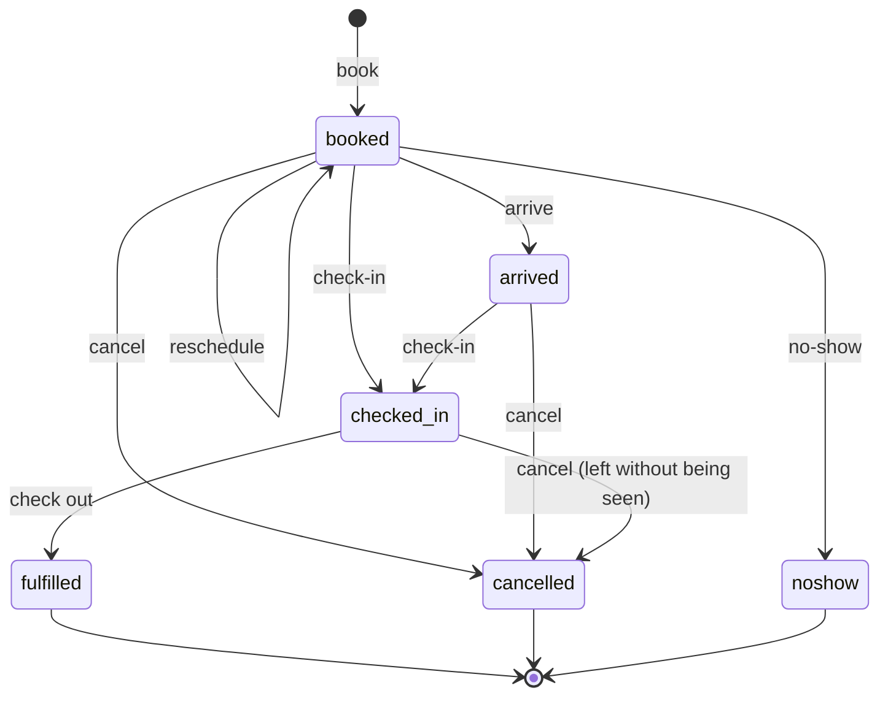
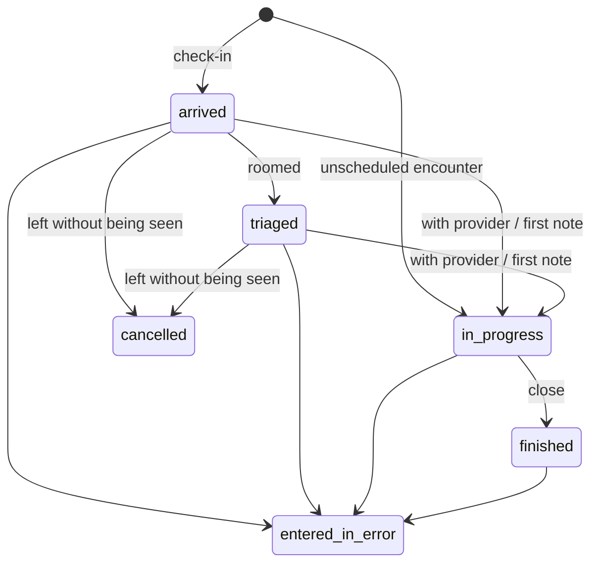
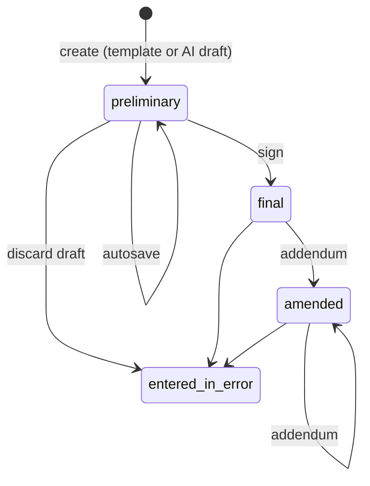
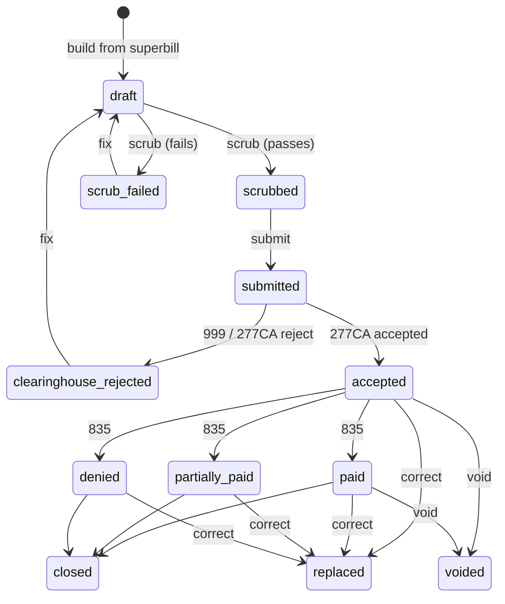

# Data ownership, consistency and lifecycles

Status: **PROPOSED** · Version 0.2 · 2026-10-23 · Author: Vimal (drafted with Claude Code)
**Needs sign-off from:** Anand (schema). Thulasi signed off her parts on issue #3 (2026-10-22); they are kept in §5.4–§5.6.

**Since ADR-0011 (2026-10-23):** there is one PostgreSQL 18 database. Clinical data lives in FHIR-shaped tables (Sam's schema, PR #9) and administrative data in normalized tables, in three schemas: `clinical`, `admin` and `audit` (D1, D23). There is no HAPI, so there is no mirroring, no HAPI reconciliation, no HAPI-down failure mode and no partitions.

**Pending schema lock:** exact table and column names come from the schema's data dictionary and are fixed at the 30 October lock (P0 tables only; `docs/context/P0_SCHEMA_SCOPE.md`). Every table name below is marked **pending schema lock** until then.

Fixed by source documents:

- **One database (D1, ADR-0011):** FHIR-shaped clinical tables and normalized admin tables in one PostgreSQL 18 database.
- **One transaction:** writes that belong together commit together, through each module's repository and Anand's helpers in `backend/app/db/` (root `CLAUDE.md`).
- **Outbox for partners only (D25):** labs, e-prescribing, clearinghouse, fax and SMS.
- **Signed records:** signing locks the row and writes its `Provenance` in the same transaction; every version is kept in `_history` (D8). The signed note row is the legal record.
- **No DELETE on clinical tables:** corrections use `entered-in-error`. A diagnosis removed before signing is set to `entered-in-error` with a reason and a Provenance record, and is excluded everywhere except audit (D24, §2.5).
- **Outside systems** read the read-only `/fhir` API (D22). Our screens use `/api/v1` only.

---

## 1. Storage patterns

| Code | Pattern | Consistency | Used for |
|---|---|---|---|
| **Cl** | **Clinical**: FHIR-shaped table in schema `clinical` | One transaction; the database keeps every version in `_history` | The 27 P0 FHIR resources: Patient, RelatedPerson, Practitioner, PractitionerRole, Organization, Location, Schedule, Appointment, Encounter, Composition, Condition, AllergyIntolerance, Observation, Procedure, FamilyMemberHistory, Medication, MedicationRequest, MedicationStatement, MedicationDispense, DetectedIssue, ServiceRequest, Specimen, DiagnosticReport, DocumentReference, Consent, Coverage, Provenance (P0_SCHEMA_SCOPE.md) |
| **Ad** | **Admin**: normalized table in schema `admin` | One transaction | Settings, users and roles, scheduling setup, visit flow, templates and favorites, CDS rules, inbox, compendium, eligibility, billing and claims, communications, AI records, duplicates and merges, integration messages |
| **Au** | **Audit**: append-only, hash-chained, in schema `audit` | Insert only, in the same transaction as the change it records | Audit events, break-glass |
| **F** | Files | File service; the database stores the file ID and hash | Card images, audio, PDFs, faxes, raw partner payloads (TA §6) |
| **C** | Computed | Read-only query over the tables above | Slots, status board, timeline, reports, dashboards |

## 2. Resources

US Core profiles are named from **US Core 9.0.0**, the current published version on hl7.org (checked 2026-10-22). The version we target is **needed before the 30 October schema lock** (DECISIONS.md "Still open", owner Anand with management on ONC).

### 2.1 Vimal's resources

| Resource | API (base `/api/v1`) | Record | FHIR resource | US Core profile | Concurrency | Tables (pending schema lock) |
|---|---|---|---|---|---|---|
| Patient (demographics, contacts) | `/patients`, `/patients/{patientId}` | **Cl** | Patient | US Core Patient | Row version → ETag; `If-Match` on PATCH | Patient and its child tables |
| Patient identifiers (MRN, driver's license) | `/patients/{patientId}/identifiers` | **Cl** (child of Patient) | Patient.identifier | (US Core Patient) | Parent's ETag | Patient identifier child table; MRN numbering per practice is an approved P0 item |
| Related persons, emergency contacts | `/patients/{patientId}/related-persons` | **Cl** | RelatedPerson (emergency contacts, guarantors, subscribers; P0_SCHEMA_SCOPE.md) | US Core RelatedPerson | Row version | RelatedPerson |
| Coverage (insurance) | `/patients/{patientId}/coverages` | **Cl** | Coverage | US Core Coverage | Row version; `If-Match` on PATCH | Coverage; payers in **Ad** |
| Card images | `…/coverages/{coverageId}/card-images` | **F** | — | — | Append-only | File IDs on Coverage |
| Consents | `/patients/{patientId}/consents` | **Cl** | Consent | none in US Core 9.0.0 | Insert-only; revocation is a new version | Consent |
| Preferred pharmacy | `/patients/{patientId}/preferred-pharmacy` | **Ad** | — | — | Row version | Preferred-pharmacy table |
| Restriction flag | `/patients/{patientId}/restrict`, `/unrestrict` | **Cl** | Patient (restricted-chart flag) | — | State action | Patient |
| Timeline | `/patients/{patientId}/timeline` | **C** | — | — | Read-only | — |
| Duplicates, merges | `/duplicates`, `/duplicates/{duplicateId}/merge`, `/patient-merges/{mergeId}/undo` | **Ad** + **Cl** | Patient.link (`replaced-by` / `replaces`) | US Core Patient | Lock both patients during merge | Duplicate and merge tables |
| Slots | `/slots` | **C** | Slot is computed, not stored | — | Read-only | Availability rules, exceptions, Appointment |
| Appointment | `/appointments`, `/appointments/{appointmentId}` | **Cl** | Appointment | none in US Core 9.0.0 | Row version; no double booking (database exclusion constraint, plus the provider-day lock, VG Step 3) | Appointment; visit flow in **Ad** |
| Status board | `/status-board` | **C** | — | — | Read-only | — |
| Eligibility check | `/eligibility-checks`, `/appointments/{appointmentId}/eligibility-checks` | **Ad** + **F** (raw X12) | — | — | Insert-only; status by system | Eligibility tables |
| Encounter | `/encounters`, `/encounters/{encounterId}` | **Cl** | Encounter | US Core Encounter | Row version | Encounter |
| Vitals | `/encounters/{encounterId}/vitals`, `/patients/{patientId}/vitals` | **Cl** | Observation (category `vital-signs`) | US Core Vital Signs, plus the specific profiles (Blood Pressure, Body Height, Body Weight, BMI, Body Temperature, Heart Rate, Respiratory Rate, Pulse Oximetry, Head Circumference) | Insert-only; corrections are entered-in-error + new | Observation |
| Encounter diagnoses | `/encounters/{encounterId}/diagnoses` | **Cl** | Condition (category `encounter-diagnosis`) | US Core Condition Encounter Diagnosis | Row version; see §2.5 | Condition |
| Code search | `/codes/search` | **Ad** (terminology) | — | — | Read-only | Terminology tables |
| Note (draft, versions, signed) | `/encounters/{encounterId}/notes`, `/notes/{noteId}`, `/notes/{noteId}/versions` | **Cl** | Composition + Provenance (P0_SCHEMA_SCOPE.md: clinical notes, signing, co-signature, addenda) | US Core Provenance. Composition has no US Core profile in 9.0.0; US Core exposes clinical notes through DocumentReference, so how `/fhir` presents notes is part of Anand's facade design (guide v2, Step 5) | Row version; `If-Match` on PATCH and sign (VG Step 5); versions in `_history` | Composition and its sections |
| Addendum | `/notes/{noteId}/addenda` | **Cl** | Composition (addendum) + Provenance | US Core Provenance | Insert-only | **pending schema lock** |
| Co-signature | `/notes/{noteId}/cosign` | **Cl** | Provenance (co-signer as an additional agent) | US Core Provenance | `If-Match` on the note | Composition, Provenance; co-signature rules in **Ad** |
| Co-signature rules | `/cosign-rules` | **Ad** | — | — | Row version | Co-signature rules by state and provider |
| Favorites | `/me/favorites` | **Ad** | — | — | Row version, PUT with `If-Match` | Templates and favorites |
| After-visit summary | `/encounters/{encounterId}/after-visit-summary` | **F** + **Cl** | Composition (after-visit summary) | — | Generated per signed note version | Composition; PDF in file storage |
| Problem list | `/patients/{patientId}/problems` | **Cl** | Condition (category `problem-list-item`) | US Core Condition Problems and Health Concerns | Row version; `If-Match` on PATCH | Condition |
| Allergies | `/patients/{patientId}/allergies` | **Cl** | AllergyIntolerance | US Core AllergyIntolerance | Same | AllergyIntolerance |
| Family history | `/patients/{patientId}/family-history` | **Cl** | FamilyMemberHistory | US Core FamilyMemberHistory | Insert + entered-in-error | FamilyMemberHistory |
| Social history | `/patients/{patientId}/social-history` | **Cl** | Observation (category `social-history`) | US Core Smoking Status Observation (smoking); US Core Simple Observation or Observation Occupation for others | Insert + entered-in-error | Observation; occupation, industry and tribal affiliation are an approved P0 item |
| Surgical history | `/patients/{patientId}/surgical-history` | **Cl** | Procedure | US Core Procedure | Insert + entered-in-error | Procedure |
| Encounter audio | `/encounters/{encounterId}/audio` | **F** + **Ad** | — | — | Insert-only; needs an active recording consent of the same patient (database-enforced) | AI audio table |
| Transcription | `/ai/transcriptions` | **Ad** | — | — | Insert-only; edits are new versions | AI transcript and request tables |
| AI note draft | `/ai/note-drafts` | **Ad** → **Cl** (becomes a draft Composition) | — | — | — | AI request and suggestion tables, Composition |
| Chart summary | `/ai/chart-summaries` | **Ad** | — | — | Insert-only | AI request and suggestion tables |
| AI decision | `/ai/suggestions/{suggestionId}/decision` | **Ad** | Provenance records AI involvement on the signed note | US Core Provenance | Recorded once per suggestion (database-enforced) | AI suggestion table |
| AI settings | `/admin/ai-settings` | **Ad** | — | — | Row version, PUT with `If-Match` | AI settings table |

### 2.2 Thulasi's resources (signed off on issue #3)

| Resource | API | Record | FHIR resource | US Core profile | Concurrency |
|---|---|---|---|---|---|
| Users, roles | `/users`, `/roles`, `/users/{userId}/roles` | **Ad** (synced with Keycloak) | Practitioner link for clinical users | US Core Practitioner | Row version |
| Audit events | `/audit-events`, `/reports/chart-access` | **Au** (append-only, per-clinic hash chain) | AuditEvent is served from the audit table | — | Append-only |
| Break-glass grants | `/patients/{patientId}/break-glass` | **Au** | — | — | Insert-only |
| Integration messages | `/admin/integration-messages` | **Ad** + **F** (raw payloads) | — | — | System only |
| Medication list | `/patients/{patientId}/medications` | **Cl** | MedicationStatement (medication list and reconciliation, P0_SCHEMA_SCOPE.md); see **NEEDS DECISION** below for how `/fhir` presents it under US Core | US Core MedicationRequest; US Core Medication | Row version |
| Prescription | `/prescriptions` | **Cl** | MedicationRequest + Provenance | US Core MedicationRequest; US Core Provenance | `If-Match` on edits and sign-and-send |
| Safety alerts, overrides | `/prescriptions/{prescriptionId}/safety-check`, `/alerts/{alertId}/override` | **Cl** | DetectedIssue (rule-based alerts and override reasons) | — | Insert-only |
| Refill and change requests | `/refill-requests` with `type`: `renewal` \| `change` (T35) | **Ad** (e-prescribing transactions) | MedicationRequest on approval | US Core MedicationRequest | State machine |
| Pharmacy directory | `/pharmacies` | **Ad** | — | — | Read-only |
| Outside medication history | `/patients/{patientId}/medication-history/fetch` | **Cl** | MedicationDispense | US Core MedicationDispense | Insert-only |
| Lab compendium | `/lab-compendium` | **Ad** | — | — | Read-only (loaded by Anand's onboarding) |
| Order | `/orders` | **Cl** | ServiceRequest + Provenance | US Core ServiceRequest; US Core Provenance | `If-Match` on edits |
| Order status history | (inside `/orders/{orderId}`) | **Ad** | — | — | Append-only |
| Specimen | (inside orders) | **Cl** | Specimen | US Core Specimen | — |
| Result | `/results` | **Cl** | DiagnosticReport + Observation | US Core DiagnosticReport Profile for Laboratory Results Reporting; US Core Laboratory Result Observation | Versions by lab corrections; a final result changes only as `corrected` / `amended` (database-enforced) |
| Result acknowledgement | `/results/{resultId}/acknowledge` | **Ad** | — | — | Insert-only |
| Unmatched results | `/unmatched-results` | **Ad** + **F** | — | — | State machine |
| In-office results | `/encounters/{encounterId}/in-office-results` | **Cl** | Observation | US Core Laboratory Result Observation or US Core Observation Clinical Result (Anand, with the US Core version) | Insert-only |

**NEEDS DECISION (Thulasi, Anand):** Thulasi's T36 represents the medication list as MedicationRequest with `intent` and `reported[x]`, which is how US Core profiles it. The approved P0 scope puts the medication list in a MedicationStatement table. Both tables exist in Sam's schema. It needs deciding whether `/api/v1` writes the list to MedicationStatement and `/fhir` presents it as US Core MedicationRequest, or the list is kept in MedicationRequest.

### 2.3 Anand's resources

| Resource | API | Record | FHIR resource | US Core profile |
|---|---|---|---|---|
| Files | `/files/…` | **F** + **Ad** metadata | — | — |
| Facilities, locations | `/facilities`, `/locations` | **Cl** | Organization, Location | US Core Organization, US Core Location |
| Providers | `/providers` | **Cl** | Practitioner, PractitionerRole | US Core Practitioner, US Core PractitionerRole |
| Appointment types, provider schedules, fee schedules, lab accounts, note templates | `/appointment-types`, `/provider-schedules`, `/fee-schedules`, `/lab-accounts`, `/note-templates` | **Ad** (provider calendars as FHIR Schedule in **Cl**) | Schedule (for provider calendars) | — |
| Payers | `/payers` | **Ad** (also an Organization where FHIR needs one) | Organization | US Core Organization |
| Onboarding import | `/onboarding/import` | **Ad** + **F** | — | — |
| Superbill, charges | `/encounters/{encounterId}/superbill` | **Ad** | — | — |
| Claims, claim status events | `/claims` | **Ad** + **F** (X12) | — (FHIR Claim not used) | — |
| Patient payments, card sessions | `/patients/{patientId}/payments`, `/payments/card-session` | **Ad** (card data stays with the processor, FRS FR-RCM-03; card numbers are rejected by the database) | — | — |
| Remittances | `/remittances` | **Ad** + **F** (835) | — | — |
| Billing reports | `/reports/ar-aging`, `/reports/charges-payments` | **C** | — | — |
| Documents | `/documents`, `/patients/{patientId}/documents` | **Cl** + **F** | DocumentReference | US Core DocumentReference |
| Faxes, fax inbox | `/faxes`, `/fax-inbox` | **Ad** + **F**; filed faxes become DocumentReference (**Cl**) | DocumentReference | US Core DocumentReference |
| C-CDA import and export | `/ccda/import`, `/patients/{patientId}/ccda` | **Cl** + **F** | DocumentReference | US Core DocumentReference |
| Inbox, messages | `/inbox`, `/messages` | **Ad** (staff messages are an approved P0 item) | — | — |
| Exports | `/exports` | **Ad** + **F** | — | — |

### 2.4 Minalini's resources

| Resource | API | Record |
|---|---|---|
| Message templates | `/message-templates` | **Ad** |
| Communication preferences | `/patients/{patientId}/communication-preferences` | **Ad** |
| Communications log | `/patients/{patientId}/communications` | **Ad** |
| Operations dashboard | `/dashboards/operations` | **C** (plain queries) |

### 2.5 Encounter diagnoses (decided)

Option B ("draft in ours, write to HAPI on signing") is **replaced by ADR-0011**: there is no HAPI, so a diagnosis is a Condition row in our database from the start.

| Step | What happens |
|---|---|
| Add | `POST /encounters/{encounterId}/diagnoses` inserts a Condition (category `encounter-diagnosis`) with Provenance, in one transaction |
| Remove before signing | `POST …/diagnoses/{diagnosisId}/remove` sets `verificationStatus = entered-in-error` with a reason, and writes a Provenance record of who removed it and why, in one transaction (D24). The diagnosis is then excluded from the chart, the problem list, decision support, AI summaries, claims and patient-facing views; it is kept only for audit. No DELETE |
| After signing | Only `POST …/diagnoses/{diagnosisId}/entered-in-error` with a reason; a diagnosis added later is a new Condition |
| "The encounter is signed" | Its first note reaches `final` (§5.3) |
| Billing | A charge can only point at a diagnosis on its own encounter (database-enforced composite key). The database refuses a charge or claim line that points at an entered-in-error diagnosis (D24) |

## 3. Consistency

### 3.1 One transaction

1. A request's writes, including clinical rows, admin rows, Provenance, the audit event and any outbox row for a partner, commit in **one database transaction**, or none of them do.
2. Each module writes through its own repository, using Anand's helpers in `backend/app/db/`. The helpers handle child tables, versions, Provenance and entered-in-error (Anand's guide v2, Step 3).
3. `tenant_db` sets `app.current_tenant_id`, `app.current_user_id` and `app.correlation_id` for the transaction; forced row-level security does the rest (D21).
4. No module reads or writes another module's tables directly; it calls that module's service.

### 3.2 Signed records (notes, prescriptions, orders)

1. Signing locks the row in the same transaction: signed content is frozen and the database blocks signed → draft.
2. The `Provenance` row is written in that transaction.
3. The database writes every committed version, with its child rows, to `_history` (read-only for the API).
4. **The signed note row is the legal record.** There is no second copy and no hash comparison.
5. Partner messages for signed prescriptions and orders (NewRx, ORM) are queued through the outbox in the same transaction (§3.3).

### 3.3 The outbox: external partners only (D25)

1. **Transactional.** `enqueue(db, partner, message_type, payload, idempotency_key, ordering_key=None)` writes the outbox row in the caller's transaction (Thulasi, T29). Its signature change comes as a separate core PR that all four review.
2. **Partners only:** labs, e-prescribing, clearinghouse, fax and SMS. It is never used for writes to our own database.
3. **Retries.** Exponential backoff with jitter. After the retry limit the job goes to the dead-letter queue with an alert, and an operator can replay it (`/admin/integration-messages/{id}/replay`, TA §7.1).
4. **Inbound partner data** (results, acknowledgements, replies) is filed by the integration worker's role in one transaction (D23).

### 3.4 Clinic isolation

There are no partitions. Clinic isolation is:

- **forced row-level security** on every clinic table, read from the settings `tenant_db` sets;
- **clinic-carrying links:** composite foreign keys that include the clinic ID, so a row can only point at a row of the same clinic;
- **same-patient links:** composite foreign keys that include the patient, so a patient's row can only point at the same patient's rows;
- **database roles that never bypass RLS** (D23).

Outside `/fhir` clients get their clinic from their machine token through Thulasi's core code (D22).

## 4. Concurrency control summary

| Kind | Mechanism | Source |
|---|---|---|
| Edits | Optimistic: row version → strong `ETag`; `If-Match` required on PATCH/PUT | VG Step 1; API_STANDARDS §11; ADR-0008 |
| Signing and co-signing | `If-Match` required: you sign exactly the version you saw | VG Step 5 |
| Booking | Database exclusion constraint against double booking, plus the provider-day lock in the booking transaction | VG Step 3; Sam's schema |
| Merge and undo merge | Lock both patient rows in a fixed order (lower UUID first) to avoid deadlocks | **PROPOSED** |
| State transitions | Guarded in the service with `SELECT … FOR UPDATE`, then checked against §5; signed and final states are also guarded by database triggers | **PROPOSED**; Sam's schema |
| Partner-bound actions | `Idempotency-Key` | VG Step 1; ADR-0007 |

## 5. Lifecycle state machines

Every state change goes through an action endpoint, never PATCH (API_STANDARDS §7.3). A transition not listed here → `409 invalid-state-transition`. Roles use the codes in SECURITY_MODEL §4.3. FHIR codes are used where FHIR defines the states.

### 5.1 Appointment (clinical `Appointment`; FHIR Appointment.status codes) — owner Vimal

| From → To | Endpoint | Who | Guards | Side effects |
|---|---|---|---|---|
| — → `booked` | `POST /appointments` | FD, ADM (`appointments:create`) | Patient active and not merged; slot free under the provider-day lock, unless the appointment type allows overbooking (FRS FR-SCH-01) | Eligibility check queued (VD-G3); reminders scheduled (Minalini); `appointment.booked` |
| `booked` → `booked` | `PATCH /appointments/{appointmentId}` | FD, ADM (`appointments:update`) | Same as booking | Eligibility re-queued if the date changes (**PROPOSED**); `appointment.rescheduled` |
| `booked` → `arrived` | `POST /appointments/{appointmentId}/status` `{ "status": "arrived" }` | FD (`appointments:status`) | Same day | `appointment.status-changed` |
| `booked`/`arrived` → `checked-in` | `POST /appointments/{appointmentId}/check-in` | FD (`appointments:check-in`) | Same day; insurance or self-pay recorded | Encounter created by the encounter service (VD-G4); real-time eligibility check (VD-G3); copay prompt; `appointment.checked-in` |
| `checked-in` → `fulfilled` | `POST /appointments/{appointmentId}/status` `{ "status": "checked-out" }` | FD | Encounter at least `in-progress` | `appointment.checked-out`. The encounter may stay open until notes are signed |
| `booked`/`arrived` → `cancelled` | `POST /appointments/{appointmentId}/cancel` `{ reasonCode, reasonText? }` | FD, ADM (`appointments:cancel`) | Reason required | Slot freed; reminders cancelled; `appointment.cancelled` |
| `checked-in` → `cancelled` | Same, `reasonCode: left-without-being-seen` | FD, ADM | Encounter not `in-progress` | Encounter → `cancelled`; `appointment.cancelled` |
| `booked` → `noshow` | `POST /appointments/{appointmentId}/status` `{ "status": "noshow" }` | FD | Start time passed | `appointment.status-changed` |

**Visit status** (FRS FR-SCH-02: arrived, checked in, roomed, with provider, checked out) is shown on the status board and derived from appointment + encounter states. `POST /appointments/{appointmentId}/status` accepts `arrived`, `roomed`, `with-provider`, `checked-out`, `noshow`; `roomed` and `with-provider` change the **encounter** (§5.2). **PROPOSED**: one command endpoint for the front-desk and rooming screens, with each state stored where it belongs.

### 5.2 Encounter (clinical `Encounter`; FHIR R4 Encounter.status) — owner Vimal

| From → To | Endpoint | Who | Guards | Side effects |
|---|---|---|---|---|
| — → `arrived` | Check-in (§5.1) | System (encounter service, triggered by FD) | Appointment checked in | Encounter row written in the check-in transaction (§3.1) |
| — → `in-progress` | `POST /encounters` `{ patientId, class, type, reason }` | MD, APP (`encounters:create`) | Type is unscheduled (telephone, documentation-only) (VD-G4) | `encounter.opened` |
| `arrived` → `triaged` | `POST /appointments/{appointmentId}/status` `{ "status": "roomed" }` | MA, RN | — | `encounter.status-changed` |
| `arrived`/`triaged` → `in-progress` | `…/status` `{ "status": "with-provider" }`, **or** automatically on the first `POST /encounters/{encounterId}/notes` | MD, APP, RN | — | `encounter.status-changed` |
| `in-progress` → `finished` | `POST /encounters/{encounterId}/close` | MD, APP (`encounters:close`) | At least one note signed; no open drafts; at least one diagnosis for billable encounter types (**pending clinical advisors**, DECISIONS "Still open") | `encounter.closed` → Anand's billing builds the superbill (VG Step 5) |
| `arrived`/`triaged` → `cancelled` | Appointment cancel with `left-without-being-seen` | FD, ADM | Not `in-progress` | Same transaction as the cancellation |
| any → `entered-in-error` | `POST /encounters/{encounterId}/entered-in-error` `{ reason }` (new, VD-G6) | MD, APP, ADM (`encounters:entered-in-error`) | All notes entered-in-error first; superbill not yet claimed (**pending schema lock**); ADM only for an encounter with no signed note (T14) | `encounter.entered-in-error`; billing notified |

No reopening of `finished` encounters in the MVP: late information goes in addenda (FRS FR-ENC-01). **PROPOSED.**

Co-signature still pending does **not** block closing; billing holds the claim until co-signature is complete (**pending Anand / RCM analyst**).

### 5.3 Note (clinical `Composition`; FHIR Composition.status) — owner Vimal

The note's `status` uses Composition.status codes: `preliminary` (draft), `final` (signed), `amended` (signed with addenda), `entered-in-error`. A separate `cosignStatus`: `not-required`, `pending`, `cosigned`.

| From → To | Endpoint | Who | Guards | Side effects |
|---|---|---|---|---|
| — → `preliminary` | `POST /encounters/{encounterId}/notes` `{ templateId }` | MD, APP, RN (`notes:create`) | Encounter not `finished`/`entered-in-error` | Encounter → `in-progress` if earlier |
| — → `preliminary` (AI) | `POST /ai/note-drafts` → operation; the AI gateway saves the draft **through the notes service** (VD-G11) | MD, APP (`note-drafts:create`) | AI feature on; recording consent present | Note `origin: ai-draft`, author = requesting clinician; each AI section linked to an `ai_suggestion` |
| `preliminary` → `preliminary` | `PATCH /notes/{noteId}` with `If-Match` | Author only | Version matches | New draft version (**pending schema lock**: every autosave vs periodic snapshots in `_history`) |
| `preliminary` → `final` | `POST /notes/{noteId}/sign` with `If-Match` | Author with `notes:sign` (MD, APP; RN for nursing notes) | Required sections complete (**pending clinical**); **every AI suggestion in the note has an accept, edit or reject decision** (FRS §3.4, §8) | Row locked; Provenance written in the same transaction (§3.2); version kept in `_history`; `cosignStatus = pending` if a co-signature rule matches; `note.signed`; inbox item for the co-signer |
| `final`/`amended` (co-sign) | `POST /notes/{noteId}/cosign` with `If-Match` | Supervising MD (`notes:cosign`) | `cosignStatus = pending`; co-signer ≠ author; co-signer allowed by the rule | `cosignStatus = cosigned`; Provenance with the co-signer, same transaction; `note.cosigned` |
| `final`/`amended` → `amended` | `POST /notes/{noteId}/addenda` `{ text }` | MD, APP, RN (`note-addenda:create`) | — | Addendum stored and locked at once, with its Provenance, in one transaction (form **pending schema lock**); `note.amended` |
| `preliminary` → `entered-in-error` | `POST /notes/{noteId}/entered-in-error` `{ reason }` (new, VD-G6) | Author (`notes:entered-in-error`) | — | Draft kept for audit, hidden from the chart |
| `final`/`amended` → `entered-in-error` | Same | Author, MD, APP | Reason required | Status `entered-in-error`, with Provenance; `note.entered-in-error`; billing notified if the encounter is closed |
| `final` → any edit | `PATCH /notes/{noteId}` | — | — | Always `409 record-locked` |

### 5.4 Prescription (clinical `MedicationRequest`; FHIR MedicationRequest.status) — owner Thulasi, agreed (issue #3, T31–T35)

`status` (FHIR): `draft`, `active`, `cancelled`, `stopped`, `completed`, `entered-in-error`. `transmissionStatus` (ours): `not-sent`, `queued`, `sent`, `accepted`, `rejected`, `error`, `cancel-requested` (T35: the screen shows a cancel waiting for the pharmacy).

| From → To | Endpoint | Who | Guards | Side effects |
|---|---|---|---|---|
| — → `draft` | `POST /prescriptions` | MD, APP, RN, MA per clinic protocol (`prescriptions:create`; ‡ pending clinical advisors) | — | — |
| read | `GET /prescriptions/{prescriptionId}` (T31) | `prescriptions:read` | — | — |
| `draft` → `draft` | `PATCH /prescriptions/{prescriptionId}` with `If-Match` (T31) | Author (`prescriptions:update`) | **Drafts only**; a signed prescription → `409 record-locked` | New draft version |
| `draft` (safety check) | `POST /prescriptions/{prescriptionId}/safety-check` | System on request | — | Alerts created as DetectedIssue (rule-based, TA §5.4) |
| Alert overridden | `POST /alerts/{alertId}/override` `{ reason }` | MD, APP (`alerts:override`) | Reason required for high severity (FRS §3.4) | Audited |
| `draft` → `active` | `POST /prescriptions/{prescriptionId}/sign-and-send` with `If-Match` + `Idempotency-Key` | MD, APP (`prescriptions:sign-and-send`) | Safety check run on this version; high-severity alerts overridden; controlled substances blocked until EPCS (P1, TA ADR-17) | Row locked; Provenance in the same transaction; eRx NewRx queued through the outbox (partner, D25); `transmissionStatus: queued`; `prescription.signed` |
| transmission updates | none (integration engine and `/hooks/erx`) | System | — | `queued` → `sent` → `accepted` / `rejected` / `error`; failures go to the prescriber's inbox; `prescription.transmission-updated` |
| `active` → `cancelled` | `POST /prescriptions/{prescriptionId}/cancel` `{ reason }` with `Idempotency-Key` | MD, APP | — | CancelRx sent; `transmissionStatus: cancel-requested`; becomes `cancelled` when the pharmacy confirms; on denial stays `active`, inbox item |
| `active` → `stopped` + new `active` | `POST /prescriptions/{prescriptionId}/change` with `If-Match` + `Idempotency-Key` | MD, APP | — | The prescriber's change is a **CancelRx plus a NewRx**, the new prescription linked to the old by `replaces` (T35) |
| Pharmacy-initiated change | none (`/hooks/erx`, NCPDP RxChangeRequest) | System | — | Arrives as a refill request with `type: change`; answered with `POST /refill-requests/{refillRequestId}/respond`, like renewals. Depends on the e-prescribing vendor (T35) |
| `active` → `stopped` | `POST /medications/{medicationId}/discontinue` `{ reason }` | MD, APP | — | — |
| `draft` → `entered-in-error` | `POST /prescriptions/{prescriptionId}/entered-in-error` `{ reason }` (T34) | Author (`prescriptions:entered-in-error`) | **Drafts only**; anything already sent uses cancel → otherwise `409 invalid-state-transition` | Kept for audit |

### 5.5 Order (clinical `ServiceRequest`; FHIR ServiceRequest.status) — owner Thulasi, agreed (issue #3, T32–T34)

`status` (FHIR): `draft`, `active`, `completed`, `revoked`, `entered-in-error`. `fulfillmentStatus` (ours, FRS FR-ORD-01): `signed`, `transmitted`, `acknowledged`, `specimen-collected`, `partial-result`, `final-result`, `cancelled`.

| From → To | Endpoint | Who | Guards | Side effects |
|---|---|---|---|---|
| — → `draft` | `POST /orders` | MD, APP, RN (`orders:create`; ‡ pending clinical advisors) | — | — |
| read | `GET /orders/{orderId}` (T32) | `orders:read` | — | — |
| `draft` (necessity check) | `POST /orders/{orderId}/medical-necessity-check` | System on request | — | Sets `abnRequired` (FRS FR-ORD-01) |
| `draft` → `active` (`signed`) | `POST /orders/{orderId}/sign-and-send` with `Idempotency-Key` | MD, APP (`orders:sign-and-send`) | AOE answers complete; at least one ICD-10-CM diagnosis linked; ABN signed or refusal recorded when required | Row locked; Provenance in the same transaction; HL7 order queued through the outbox (partner, D25) |
| requisition, labels | `GET /orders/{orderId}/requisition`, `GET /orders/{orderId}/labels` (T33) | `orders:read` | — | Generated on demand through the file service; returns a download link; audited as `export` |
| `signed` → `transmitted` → `acknowledged` → `specimen-collected` → `partial-result` → `final-result` | none (integration engine) | System | — | Status events stored (order status history, **Ad**); `order.status-changed`; on `final-result`, FHIR `completed` |
| `draft`/`active` → `revoked` (`cancelled`) | `POST /orders/{orderId}/cancel` `{ reason }` | MD, APP (`orders:cancel`) | **Only before `specimen-collected`**; after that → `409 invalid-state-transition` (T34) | Cancel message to the lab if transmitted |
| `draft` → `entered-in-error` | `POST /orders/{orderId}/entered-in-error` `{ reason }` | Author (`orders:entered-in-error`, T13) | **Drafts only**, mirroring prescriptions (confirmed by Thulasi, issue #3); a signed order uses cancel, before `specimen-collected`; otherwise `409 invalid-state-transition` | Kept for audit |

### 5.6 Result (clinical `DiagnosticReport` + `Observation`; FHIR DiagnosticReport.status) — owner Thulasi, agreed (issue #3, T34–T35)

Two independent dimensions:

- **Report status (FHIR, set only by the lab via the integration engine):** `registered` → `partial` → `preliminary` → `final` → `corrected` / `amended`; or `cancelled`, `entered-in-error`.
- **Review status (ours):** `unreviewed` → `acknowledged`.

| Transition | Endpoint | Who | Guards | Side effects |
|---|---|---|---|---|
| Message received, matched | none | System | Placer/filler number and patient identifiers match (TA §10.4) | DiagnosticReport + Observations filed in one transaction by the integration worker (D23); review `unreviewed`; `result.received` within 60 s (FRS FR-ORD-02) |
| Message received, not matched | none | System | — | Unmatched queue item `unmatched`; never filed automatically (FRS FR-ORD-02) |
| `unmatched` → `matched` | `POST /unmatched-results/{unmatchedResultId}/match` `{ patientId, orderId? }` | RN, MD (`unmatched-results:match`) | `orderId` is **optional**, for outside results that have no order of ours (T35) | Filed as above |
| `unmatched` → `rejected` | `POST /unmatched-results/{unmatchedResultId}/reject` `{ reason }` (T34) | RN, MD (`unmatched-results:reject`) | Reason required | Rejected items are kept and can be reviewed, never deleted |
| `unreviewed` → `acknowledged` | `POST /results/{resultId}/acknowledge` | Ordering clinician or covering MD, APP (`results:acknowledge`) | — | Critical-result escalation stops; `result.acknowledged` |
| Corrected or amended report | none | System | — | New report version; review resets to `unreviewed`; clinician re-notified (TA §10.4) |
| In-office result | `POST /encounters/{encounterId}/in-office-results` | MA, RN, MD, APP | — | `final` at once; `unreviewed` unless entered by a clinician |

### 5.7 Claim (admin) — owner Anand

| From → To | Endpoint | Who | Guards | Side effects |
|---|---|---|---|---|
| — → `draft` | `POST /claims` `{ superbillId }` | BIL (`claims:create`) | Encounter `finished`; superbill reviewed; co-signature complete if required | — |
| `draft` → `scrubbed` / `scrub-failed` | `POST /claims/{claimId}/scrub` | BIL | — | Edit results stored |
| `scrubbed` → `submitted` | `POST /claims/{claimId}/submit` with `Idempotency-Key` | BIL (`claims:submit`) | — | 837P queued to the clearinghouse (FRS FR-RCM-02) |
| `submitted` → `clearinghouse-rejected` / `accepted` | none (999, 277CA via `/hooks/clearinghouse`) | System | — | `claim_status_event`; `claim.status-changed` |
| status checks | `POST /claims/{claimId}/status-check` with `Idempotency-Key` | BIL | — | 276 sent; 277 updates status |
| `accepted` → `paid` / `partially-paid` / `denied` | none (835 posting, `POST /remittances/{remittanceId}/post`) | BIL / system | — | Payments posted |
| → `replaced` | `POST /claims/{claimId}/correct` | BIL | — | New claim with frequency code 7 linked to the old |
| → `voided` | `POST /claims/{claimId}/void` | BIL | — | Void claim with frequency code 8 |
| `paid`/`partially-paid`/`denied` → `closed` | none, or by biller when the balance is settled (**pending schema lock**) | BIL / system | — | — |

### 5.8 Eligibility check (admin) — owner Vimal

| From → To | Trigger | Who | Side effects |
|---|---|---|---|
| — → `pending` | Booking, nightly pre-visit batch for next-day appointments, check-in (VD-G3), or `POST /eligibility-checks` (manual) | System; FD, BIL (`eligibility-checks:create`) | 270 queued via `integration.enqueue("clearinghouse", "270", …)` (VG Step 4); `202` + operation for manual checks |
| `pending` → `complete` | 271 through Thulasi's webhook receiver | System | Coverage status (`active`, `inactive`, `unknown`), copay, deductible stored; `eligibility.completed` |
| `pending` → `error` | Partner error or timeout | System | Front desk sees "unable to verify"; can retry manually |

## 6. Open items in this document

Storage questions are settled by ADR-0011. What remains:

| Item | Owner | Blocks | Status |
|---|---|---|---|
| Exact table and column names for every resource above | Anand, Sam | 30 October schema lock | Fixed at the lock (P0 tables) |
| US Core version to target | Anand, with management (ONC) | 30 October schema lock | DECISIONS.md "Still open" |
| Medication list: MedicationStatement (P0 scope) vs MedicationRequest (T36) | Thulasi, Anand | Medication APIs | **NEEDS DECISION** (§2.2) |
| Claim close rule; co-signature hold before claiming | Anand | Pilot | As in §5.7; the claim tables are fixed at the lock |
| Close-encounter guards (is a diagnosis required?) | Clinical advisors (raised by Vimal) | Pilot | DECISIONS.md "Still open" |
| `enqueue()` signature change (§3.3) | Thulasi; all four review | Pilot (first partner integration) | Separate core PR |

**Resolved by ADR-0011** (kept for history):

- ~~mirroring of Patient, Practitioner, PractitionerRole, Organization, Location and Coverage~~;
- ~~an encounter row in ours next to a HAPI Encounter~~;
- ~~encounter diagnoses drafted in ours and written to HAPI on signing~~;
- ~~the legal-record hash between two copies~~;
- ~~clinical writes failing while HAPI is down~~;
- ~~tenant isolation through HAPI partitions and the shared-resource question (T30, A33)~~;
- ~~client-assigned HAPI IDs and our identifier system on HAPI resources~~;
- ~~emergency contacts as Patient.contact vs RelatedPerson~~ (RelatedPerson, per the approved P0 scope);
- ~~merge representation in HAPI~~ (Patient.link in our database).
